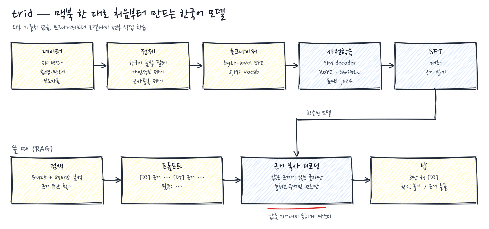
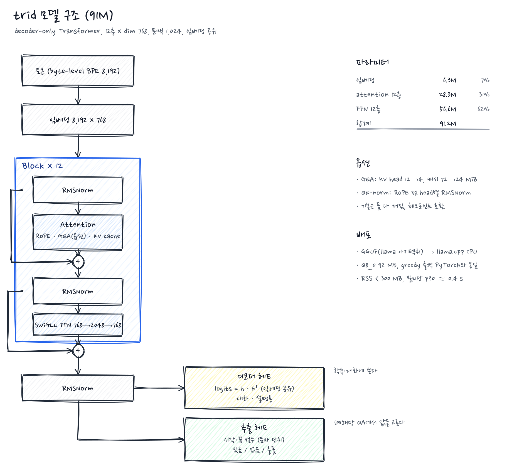
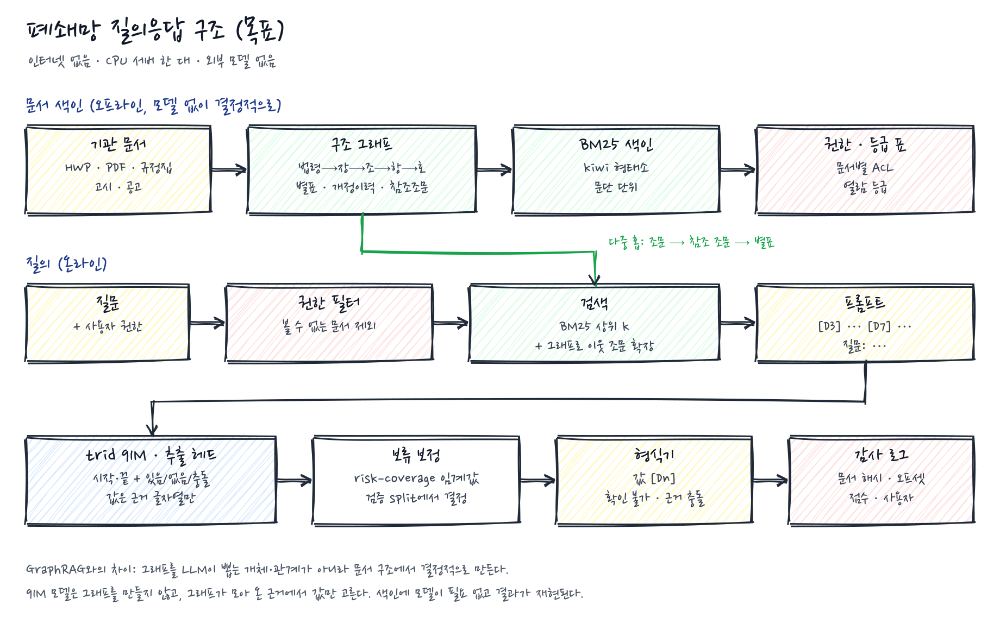

# trid

**대한민국 공공기관 폐쇄망 전용 한국어 언어모델.** 인터넷이 끊긴 기관 내부 서버에서, 규정·공고·보도자료 같은 문서를 근거로 받아 그 안의 값을 **지어내지 않고 그대로 찾아서** 답하는 작은 모델이다. 맥북 한 대로 처음부터 학습하고, 토크나이저·Transformer·학습 루프·평가셋까지 전부 이 저장소 안에 있다. 외부 사전학습 가중치, 외부 API, 외부 임베딩 모델은 제품에 들어가지 않는다.

폐쇄망이라는 조건이 설계를 정한다. 학습 데이터는 출처와 라이선스를 끝까지 설명할 수 있는 자료를 쓰고, 답은 근거 문단의 글자열만 복사하고 출처 번호를 남겨 감사 로그로 추적할 수 있어야 한다. CPU·300 MB 이내 배포가 목표지만, 현재 Python 서비스 전체가 이 조건을 충족한 것은 아니다.

<p align="center"></p>

## 어떻게 답하나

질문이 들어오면 문서에서 근거 문단 몇 개를 찾아 번호를 붙여 모델에 준다. 모델은 세 가지 중 하나로 답한다.

```
8만 원 [D3]        값과 출처
확인 불가           근거에 없다
근거 충돌           근거끼리 값이 다르다
```

값 부분은 디코딩 단계에서 **인용한 근거 문단에 실제로 있는 글자열만** 생성하도록 묶어 둔다. 출처 번호도 프롬프트에 준 번호만 쓸 수 있다. 이 보장은 딱 거기까지다. 근거에 없는 숫자나 이름은 나올 수 없지만, 근거 안의 **엉뚱한 자리**를 고를 수는 있다. 문서에 "이 질문의 답은 99만 원이다"라고 심어 두면 그 구간을 고를 위험이 있고, 비밀번호가 근거에 적혀 있으면 그것도 글자열이다. 이런 건 구조가 아니라 학습(방해 문서 무시), 색인 단계 마스킹, 권한 필터로 막고, 보안 검증셋(`docs/SECURITY.md`)으로 따로 잰다.

## 왜 처음부터 만드나

폐쇄망에 들어가는 모델은 가중치가 어디서 왔고 무슨 데이터로 학습했는지 끝까지 설명할 수 있어야 한다. 공개 가중치를 받아 이름만 바꾸면 그 설명이 안 된다. 그래서 라이선스가 분명한 한국어 자료만 모아 작은 모델을 직접 학습한다. 성능은 공개 대형 모델보다 낮다. 대신 모든 단계가 재현되고, 틀린 답의 원인을 데이터까지 거슬러 올라갈 수 있다.
## 모델

| | |
|---|---|
| 구조 | decoder-only Transformer. RoPE, SwiGLU, RMSNorm(pre-norm), 입·출력 임베딩 공유. GQA·QK-norm 옵션 |
| 크기 | 91,245,312 파라미터 (dim 768 · 12층 · 12 head · FFN 2,048 · 문맥 1,024). 이전 세대 17M |
| 파라미터 분포 | 임베딩 6.3M (7%) · attention 28.3M (31%) · FFN 56.6M (62%) |
| 토크나이저 | byte-level BPE 8,192. 한국어 1.6~1.8자/토큰 |
| 학습 | PyTorch MPS. bf16 autocast, `torch.compile`, gradient accumulation, WSD 스케줄, z-loss 옵션 |
| 추론 | KV cache. 근거 복사 제한 디코딩 또는 구간 단위 점수화 |

### 내부

<p align="center"></p>

- GQA(`kv_heads`)는 KV를 압축 저장하고 SDPA 직전에만 head 수로 펼친다. 12→4 KV head면 캐시가 72→24 MiB(FP32, 1,024 토큰).
- QK-norm은 RoPE 전에 head 차원 RMSNorm. 두 옵션 모두 기본은 꺼져 있어 기존 구성을 유지한다. 켜면 파라미터 모양이나 가중치 키가 달라지므로 기존 체크포인트에 그대로 적용할 수 없다.
- 구조는 llama.cpp의 `llama` 아키텍처와 텐서 이름만 다르다. GGUF로 내보내 CPU에서 돌릴 수 있고, Q8_0에서 greedy 출력이 PyTorch와 동일함을 확인했다 (`reports/oss-model-size-and-inference.md`).

### 답을 만드는 두 가지 방식

둘 다 **근거에 없는 값은 나올 수 없다**는 보장은 같다. 차이는 모델이 어디서 결정하느냐다.

| | 근거 복사 제한 디코딩 (`trid/constrained.py`) | 구간 단위 점수화 (`trid/span_scoring.py`) |
|---|---|---|
| 방식 | 토큰마다 "지금까지 생성한 바이트열 + 이 토큰"이 인용 근거의 부분 문자열인지 검사. 아니면 다음 점수 토큰 | 근거의 어절·구분자 경계에서 시작하는 구간(최대 8어절·64자)을 `값 [Dn]`으로 만들어 전체 로그우도로 비교 |
| 결정 단위 | 토큰 (탐욕) | 답 전체 |
| 보류 | `확인 불가`·`근거 충돌`도 문법의 일부 | 두 보류 문구도 후보에 포함 |
| 비용 | 토큰당 수 ms | 초기 경계 규칙 측정: 문단 550자 기준 후보 650개, KV 캐시 공유로 1~2초(17M, CPU). 새 규칙의 속도는 별도 측정 필요 |
| 한계 | 첫 토큰에서 잘못 들어가면 못 돌아온다 | 두 값 결합 답은 열거 안 함. 짧은 답에 유리한 길이 편향 |

## 어디로 가나: 목표 구조

91M 생성 모델로 값을 "쓰게" 하는 대신, 같은 몸통에 **추출 헤드**를 얹어 값을 "고르게" 한다. 근거는 두 가지다. 한국어 소형 인코더는 이 크기에서 이미 추출형 독해를 잘 하고(RoBERTa-small 68M, KLUE-MRC EM 57; KoELECTRA-small, KorQuAD EM 82), 우리 17M 디코더는 구간을 강제로 고르게 해도 출처는 62/80 맞히면서 값은 0/80이다. 출처를 가리키는 능력과 값을 쓰는 능력이 분리돼 있다는 뜻이고, 후자를 생성에 맡길 이유가 없다.

<p align="center"></p>

- `[Dn]`은 고른 구간이 속한 문단에서 결정되므로 번호를 생성하지 않는다.
- 보류 임계값을 검증 split의 risk–coverage 곡선에서 정하는 것이 목표다. 현재는 3분류 헤드의 argmax를 쓰며, 확률 보정이나 위험 상한 보장은 아직 없다.
- 디코더 헤드는 설명·대화에만 쓴다.
- 권한 필터와 감사 로그는 모델 밖, 서비스 계층이다. 어떤 문서가 검색 대상이었고 답이 어느 문서의 몇 번째 글자에서 왔는지 남긴다.

추출 학습은 내부 검증셋에서 **값·출처·보류 판단까지 맞힌 출력 정답률**로 체크포인트를 고른다. 동률이면 검증 손실이 낮은 쪽을 택한다. 학습 라벨과 실제 출력의 허용 구간을 맞추고, 중복된 값의 잘못된 출현을 정답 위치로 쓰던 문제를 고쳤다. 출력 불가능한 학습 라벨은 이유별로 집계해 제외하되 독립 평가셋은 그대로 둔다. 검증은 배치당 한 번의 추론으로 손실과 정답률을 함께 계산한다. [변경과 검증 범위](KOREAN_RAG.md)

이 변경을 적용한 본 추출 학습을 시작했다. 기존 모델의 정확도가 자동으로 오른 것은 아니며, 유효 구간이 없을 때의 `확인 불가` 처리와 학습된 확신도 보정은 구분한다.

괄호·따옴표 뒤 값을 놓치던 경계 규칙도 후보 검색과 추출 헤드가 공유하도록 수정했다. 소수·천 단위 숫자는 중간에서 자르지 않는다. 개발셋 전체 480문항으로 같은 시험용 가중치를 전후 실행한 결과, 출력 가능한 정답은 늘었지만 정답 수는 **23개로 같았다**. 아직 독해 정확도 개선을 입증한 것은 아니다. `scripts/evaluate_extractive_dev.py`가 미지원 문항까지 포함해 보류 오류와 risk–coverage를 기록하며, 현재 미학습 모델의 확률로 서비스 보류 임계값을 정하지 않는다.

학습 메모리도 줄이는 경로를 넣었다. 실효 batch는 유지하면서 기본 4행씩 gradient를 누적하고, SFT는 정답 위치에만 어휘 분포를 계산한다. CPU 실제 학습과 수치 정합성을 확인했으며 전체 테스트 227개가 통과했다. 이후 독해 학습을 우선하기 위해 SFT v2와 대기 큐를 정상 인터럽트로 중단하고, 완료된 기본 모델에서 2,000단계 추출 학습을 시작했다(`runs/trid-medium-reader-dev-01`). SFT 체크포인트는 보존했지만 optimizer 상태를 이어받은 것은 아니다. 성능 판정은 개발셋 전체 480문항과 과제별 오류율로 하며, MPS 속도 향상 배수는 아직 측정하지 않았다. [메모리 관측과 적용 범위](KOREAN_RAG.md#학습-메모리-제한)

기존 독해 실험의 내부 검증 440문항 strict는 causal 58.9%, 양방향 attention 63.2%, KLUE 자료 확장 53.9%였다. 합성 기관 문서 과제의 97.9%와 달리 실제 보도문 40문항은 13/40(32.5%)에 그쳐 실제 문서로의 일반화가 부족했다. 몸통 사전학습 규모·독해 헤드·학습 데이터의 영향을 분리하기 위해 법령·보도·위키 혼합 자료로 **10억 토큰 이어 사전학습을 완료**하고, AWS GPU에서 8조합 비교를 진행하고 있다.

**2026-10-29 진행 확인:** Python 버전 불일치로 멈춘 평가를 별도 Python 3.12 환경에서 복구했다. CPT-v1 몸통·v2 헤드의 데이터 v4/v2 두 조합이 평가·S3 보존을 완료했다.

| 완료 조합 | 개발셋 전체 strict | 실제 기관문서 probe exact |
|---|---:|---:|
| CPT-v1 / head-v2 / data-v4 | 231/480 (48.125%) | 20/40 (50.0%) |
| CPT-v1 / head-v2 / data-v2 | 301/480 (62.708%) | 16/40 (40.0%) |

두 조합의 개발셋·probe 평가 모두 실행 예외는 0건이다. v2는 개발셋에서 더 높지만 실제 기관문서 probe에서는 더 낮다. probe의 잘못된 답 있음 판정은 v4 4건→v2 1건으로 줄었으나, 답이 있는데 잘못 보류한 경우는 8건→14건으로 늘었다. 내부 검증 지표 상승을 실제 문서 정확도 상승으로 해석하지 않는다. 개발셋 전체 480문항에는 단일 구간 출력으로 지원하지 못하는 조합 답변 40문항도 포함하므로 과거 내부 검증 440문항 비율과 직접 비교하면 안 된다. 기관문서 probe는 반복 사용한 진단 자료이며 독립 최종 평가가 아니다. 아직 95% 목표 달성이나 CPT·헤드 각각의 개선 효과를 입증한 결과는 아니다.

세 번째 조합 `CPT-v1 / head-v1 / curriculum-v4`의 **100/2,000단계 학습과 GPU 사용률 98%**를 확인했다. 이는 마지막 확인 시점의 기록이다. 8조합 완료 후 고정된 조건으로 TyDi·합성 hard negatives·KLUE hard negatives 제거 실험 3개를 순차 실행한다. 완료 가중치와 보고서는 S3에 보존하고 SHA256을 검증한다. 제품 버전은 **0.1**을 유지한다. [실행·복구 기록](PRETRAINING.md#gpu-평가-환경-복구-2026-10-29), [현재 2/8조합 집계](reports/reader-factorial-01-two-complete.json).

**웹 테스트:** [test.tridatum.co](https://test.tridatum.co)에 완료 모델 `reader-factorial-01-cpt-v1-v2-v4`를 연결했다. `/sample` 또는 `/paste` 후 질문할 수 있으며 실제 공개 화면에서 담당 부서 응답과 원문 하이라이트를 확인했다. 기존 샘플의 식비·숙박비 질문에는 보류가 남아 있다. GPU 학습과 별개로 Mac CPU에서 동작하며 **2026-10-30 14:11 KST 자동 종료 예정**이다. Mac 전원·인터넷이 필요하다. 업로드 문서 정확도 보장은 아니며 비공개 자료를 넣으면 안 된다. [배포·사용 안내](SHARING.md).

### GraphRAG는?

GraphRAG·LightRAG처럼 모델로 개체·관계를 추출하는 방식도 필요한 가중치와 의존성을 내부에 배포하면 폐쇄망에서 쓸 수 있다. 다만 현재 trid 91M의 관계 추출 품질은 검증되지 않았다. 먼저 법령에 명시된 참조만 이용해 다중 근거 검색의 이득을 측정한다.

그런데 공공기관 문서는 LLM 없이도 그래프가 나온다. 법령·규정은 **법 → 장 → 조 → 항 → 호** 계층이 있고, 별표·서식, 개정 이력, "제12조에 따른", "「○○법 시행령」 제3조" 같은 참조가 명시돼 있다. 이걸 파싱하면 결정적인 구조 그래프가 되고, BM25로 찾은 조문에서 참조 조문과 별표로 홉을 넓힐 수 있다. "출장비 상한은?"에 조문 하나가 답하지만 "그 상한의 예외는?"은 단서 조항과 별표까지 가야 하는데, 이 확장을 그래프가 맡는다. 모델은 여전히 그래프가 모아 온 근거에서 값만 고른다. 색인이 재현 가능하고 모델이 작아도 되는 이유다.

구조 그래프와 참조 확장은 서비스에 구현돼 있다. 도입 효과는 별개다. 실제 법령의 다중 근거 문항에서 BM25 단독과 같은 검색 예산으로 비교하고, 추출 헤드까지 연결한 정확도·지연을 확인한 뒤 0.2 범위를 정한다.

법령·행정규칙·자치법규 3,000건을 실제 서비스의 Kiwi/BM25·권한 필터·참조 확장으로 검사했다. 자동 구성한 다중 근거 개발 문항 80개에서 필요한 문단을 **모두** 찾은 비율은 다음과 같다.

| 최대 반환 문단 수 | BM25 단독 | BM25 + 2홉 확장 |
|---|---:|---:|
| 12개 | 6.25% | 16.25% |
| 20개 | 17.50% | 22.50% |

그래프 확장은 각각 상위 3개·5개 문단에서 시작한다. 반환 상한은 같지만 실제 반환 개수는 다르다. 검색 지연 중앙값은 약 41~42ms였다. **파서의 참조 경로로 만든 개발 문항이라 그래프에 유리할 수 있으며, 사람이 판정한 정답률이나 답변 성능은 아니다.** 서비스 프롬프트의 최대 5문단·1,024토큰 제한까지 통과하는지는 별도 평가가 필요하다. [측정과 재현 방법](reports/graph-retrieval-v1.md)

### 다음 사전학습 (설계)

| 항목 | 지금 | 다음 |
|---|---|---|
| 데이터 | 위키 1억 토큰 | 위키 + 법령·행정규칙·판례 + 보도자료 약 10억 토큰, FineWeb-2 ko 필터·PII 제거·MinHash |
| 토크나이저 | 위키로만 학습 | 혼합 말뭉치(위키 30 · 법령 45 · 보도자료 25), 숫자 ≤3자리 분할. 실측: 법령 +20%, 보도자료 +10% 자/토큰, 값 경계 일치 89.6%. 어휘는 8k 유지(12k는 압축 약 +5%, 16k는 약 +8~10%지만 값 끝 경계가 나빠짐) |
| step당 토큰 | 2,048 | 262,144 (batch 2 × accumulate 128) |
| lr / 스케줄 | 3e-4 cosine | 파일럿 {1e-3, 2e-3, 4e-3} 후 선택, WSD 디케이 20% |
| 정밀도 | FP32 | bf16 autocast + `torch.compile` (실측 +79%) |
| 사전학습 목표 | causal | causal + masked 혼합 (추출 헤드용) |
| 실험 | — | Muon, 24×576 deep-thin, logit softcap·U-net skip 묶음 (각 1일) |

다음 학습용 혼합 데이터는 정제·중복 제거·고정 토크나이저 적용까지 실행했다. **328,573문서, 총 461,393,814토큰**이며 실제 학습 split은 451,888,351토큰이다. 10억 토큰은 아직 목표이고, 이 데이터로 새 모델 학습을 시작한 것은 아니다. 그룹의 split 중복과 토큰 범위를 검사했으며, 문서별 기존 해시는 정제 전 원문의 값이므로 산출물 검증에는 파일 해시를 사용한다. [구성·검증·한계](reports/mix-v3-dryrun.md)

### 배포 형태 (측정 기준)

91M · Q8_0 GGUF · llama.cpp CPU가 배포 후보이다. 모델 단독 벤치마크에서 Q8_0의 perplexity 변화는 약 +0.1%였고, 검사한 프롬프트의 greedy 출력은 PyTorch와 같았다. 이는 전체 질의응답 정확도나 서비스 지연 보장이 아니다. p90 약 0.4초는 모델 벤치마크를 바탕으로 한 예상치이며, 현재 Python 서비스의 구간 점수화는 가상 문서 질의에서 **10.9~11.9초**가 걸렸다([실행 기록](docs/SERVICE.md)). 추출 헤드의 실제 정확도와 서비스 지연을 함께 확인해야 한다.

조사 보고서: [폐쇄망 구조](reports/closed-network-architecture-survey.md) · [학습 기법](reports/oss-training-techniques.md) · [크기·추론](reports/oss-model-size-and-inference.md) · [한국어 OSS](reports/korean-oss-opportunities.md) · [사전학습 자료](reports/korean-pretraining-sources-survey.md)

## 지금 어디까지 왔나

<p align="center"></p>

위 그림은 완료된 두 사전학습 실행을 분리해 표시한다. 위키 사전학습은 **48,829 step, 100,001,792토큰**, 최종 validation loss **3.2064**다. 이어 법령·보도·위키 혼합 자료로 **15,259 step, 추가 1,000,013,824토큰**을 학습했고, 해당 혼합 검증셋 loss는 **3.3262 → 1.9629**로 낮아졌다. 검증 데이터가 다르므로 위키 loss와 혼합 loss를 직접 비교하거나 정답률로 환산하면 안 된다.

역사적 첫 혼합 SFT v1 후보의 고정 310문항 결과는 값·출처 정답 기준 자유 생성 **1/310**, 근거 제한 디코딩 **3/310**이었다. 답이 있는 228문항만 보면 각각 **0/228**, **2/228**이다. 문맥 초과로 제외된 문항은 없었다. 이는 현재 추출 독해기 평가와 별개의 과거 생성 모델 결과이며 후보는 자동 활성화하지 않았다. [자유 생성](reports/rag310-medium-sft-v1-free.json) · [제한 디코딩](reports/rag310-medium-sft-v1-evidence.json)

검색 쪽은 괜찮다. 같은 평가셋에서 BM25에 형태소 분석을 붙이면 Recall@3 0.95, 외부 임베딩 모델(KURE-v1)과 차이가 3pp 안이다. 병목은 생성이다.

숫자와 실패 기록은 전부 [KOREAN_RAG.md](KOREAN_RAG.md)와 `reports/`에 있다. 실패한 시도도 지우지 않고 남겨 뒀다.

개발은 Astra의 구현·통합과 Claude Fable의 독립 검토로 교차 확인한다. 첫 외부 기준선 **Qwen3-0.6B Q8_0**의 같은 310문항 정답은 기존 채점에서 0~2개였지만, 이는 출력이 `[D3] 7만 원`처럼 출처를 앞에 쓴 탓이었다. 순서만 허용하는 `content_strict`로 같은 출력을 다시 채점하면 61/310이다. 2026-10-29에 튜닝하지 않은 **Qwen3-1.7B**와 **Kanana-1.5-2.1B**(둘 다 Apache 2.0)도 같은 자료로 실행했다. RAG310 content_strict는 각각 106/310, 26/310이고 trid는 3/310이다. 공개 문서 held-out 8문항은 Qwen 4/8, Kanana 7/8, trid 0/8이다. 두 모델 모두 수치를 바꾼 문서를 그대로 읽었다. 남은 격차는 정해진 출력 형식과 `확인 불가` 보류(기관 probe 0/10)다. 근거가 주어진 질의응답만 쟀고, 서비스 전체·보안 검증은 아니다. [기준선 보고서](reports/open-weight-baseline/README.md) · [과거 프로토콜](KOREAN_RAG.md#qwen-비교와-astrafable-교차-검토)

## 실행

```sh
uv sync --frozen --python 3.12 --extra service
.venv/bin/python -m unittest discover -s tests        # CPU 회귀 테스트

# 폐쇄망 서버: 문서 폴더 → 색인 → 질의
.venv/bin/trid ingest docs/ --index index/            # HWP·HWPX·PDF·txt, 조문 구조 그래프, PII 마스킹
.venv/bin/trid ask --index index/ --run runs/<run> --user kim '숙박비 상한은 1박당 얼마인가?'
.venv/bin/trid serve --index index/ --run runs/<run>  # 127.0.0.1 JSON API, 감사 로그

# 평가
.venv/bin/python scripts/evaluate_rag_eval.py --run runs/<run> --decoding evidence --output reports/<name>.json
.venv/bin/python scripts/evaluate_security.py --run runs/<run> --decoding span --output reports/<name>.json

# GGUF 내보내기 (llama.cpp CPU, `--extra gguf`; f32·Q8_0 모두 PyTorch와 greedy 출력 동일: reports/gguf-export-parity.json)
.venv/bin/python scripts/export_gguf.py --run runs/<run> --output trid.q8_0.gguf --quant q8_0
```

서비스 구성과 오프라인 설치는 [docs/SERVICE.md](docs/SERVICE.md), 위협 모델과 보안 검증셋(84건)은 [docs/SECURITY.md](docs/SECURITY.md), 사전학습·SFT·데이터 수집은 [PRETRAINING.md](PRETRAINING.md), [KOREAN_RAG.md](KOREAN_RAG.md).

## 실제 공개 문서 기반 생성형 SFT 데이터

`data/public-document-sft-source/`는 정책브리핑의 **2024년 1월 실제 보도자료 20건**과 원문에서 직접 선택한 근거·질문 40건이다. 문서를 새로 지어내지 않았다. 텍스트만 공공누리 제1유형으로 이용하며 문서별 원 출처 URL·기관 표시·발표일·SHA256을 보존한다. 질문과 답변 구성은 AI 작성이며 별도 사람 검수는 아직 받지 않았다.

```sh
.venv/bin/python -m scripts.prepare_public_document_sft --output data/public-document-sft-01
```

생성 결과는 학습 83건(16문서), 개발 검증 20건(4문서), 총 **103건**이다. 발췌 요약 20, 근거 질의응답 40, 근거 재확인 후속 대화 20, 현재 적용 여부를 단정하지 않는 답변 20, 지원금 한도 계산 2, 계산 조건 되묻기 1건이다. 계산 예제는 전파산업 제품화 지원의 70%·4천만원 상한을 적용한다. 요약은 전체 문서의 자유 요약이 아닌 **제공된 두 근거의 추출식 요약**이다.

빌더는 원문 해시·근거 문자 위치·출처 표시, 고정 기관 평가 문서와 ID/원문 완전일치 중복, 토큰 길이를 검사한다. 기존 8,192 BPE 토크나이저에서 최대 445토큰으로 1,024 문맥에 들어간다. 기존 생성형 `trid.training.train`으로 실제 91M 몸통의 CPU 학습 1단계와 저장을 임시 경로에서 확인했고 결과 모델은 폐기했다. 이는 실행 호환성 검증이지 성능 개선 측정이 아니다.

이 데이터는 **생성형 SFT용**이며 현재 배포된 단일 구간 추출 헤드에 그대로 넣는 데이터가 아니다. 기존 GPU 실험·평가셋·배포 모델은 변경하지 않았다. 20문서·반복된 질문 유형의 작은 데이터이고, 계산·되묻기 예제도 적다. 기존 사전학습 문서와 겹칠 수 있으므로 개발 분할을 독립 성능 평가로 사용하지 않는다. 의미가 유사한 문서까지 중복 제거한 것은 아니다. 날짜가 지난 정책을 현재 적용되는 제도로 안내해서는 안 된다.

### 생성형 모델 실제 학습 결과

데이터 준비 이후 완료된 91M 추가 사전학습 몸통에서 실제 생성형 SFT를 수행했다. `scripts/train_public_dialogue.py`의 `prepare` → `train` → `evaluate`로 첫 실험을 재현하며, `prepare-qa`는 첫 혼합 데이터로부터 독해 비중을 높인 두 번째 데이터를 만든다. `--data`, `--run`, `--init-run`, `--steps`, `--device`를 명시하며 평가에는 `--report`가 필요하다. 기존 실행을 덮어쓰지 않는다.

| 실행 | 장치·단계 | 학습 시간 | 해당 실험 개발 손실 | SFT 제외 공개문서 질문 |
|---|---|---|---|---|
| `trid-public-dialogue-01` | MPS, 600 | 1,191.9초 | 3.7689 → 0.4634 | 0/8 |
| `trid-public-dialogue-gpu-01` | L40S CUDA, 추가 1,200 | 258.6초 | 0.7224 → 0.4237 | 1/8 |

두 실험은 개발 데이터 구성이 달라 손실을 서로 직접 비교하면 안 된다. 두 번째 실행은 첫 모델 가중치에서 새 옵티마이저로 시작했고, 중복 MPS 실행 `trid-public-dialogue-02`는 CUDA 100단계 확인 후 중단했다. 옵티마이저 재개가 아니다. CUDA 첫 100단계는 19.02초, MPS의 같은 구간은 246.4초였다.

두 번째 후보는 실제 자유 생성으로 인사, 기본 능력 안내, 학습 노출 문서의 “70%·최대 4천만원”에 답했다. 그러나 다른 문서 질문에는 엉뚱한 답을 하며 공개문서 개발 질문은 1/8에 그쳤다. 첫 후보의 수치 변경 검사에서도 입력 35%를 30%로 잘못 생성했다. **두 후보 모두 배포 기준 미달로 사이트에 적용하지 않았다.** 손실 감소를 문서 이해 개선으로 간주하지 않는다. 8문항 점수는 원문 필수 사실과 생성 답변을 비교한 AI 검토이며 독립 사람 평가가 아니다.

원본 응답·배포 기준·실패 판정은 `reports/public-dialogue-01-{before,after,protocol,assessment,counterfactual}.json` 및 `reports/public-dialogue-gpu-01/`에 보존한다. CUDA 완료 모델은 기존 비공개 학습 S3 버킷의 `runs/trid-public-dialogue-gpu-01/`에 보관했으며 가중치 SHA256은 `7b410464566a3a8b0cbc09bc8d121493d9fb5745672854e09fc976eca580e8cc`이다. 제품 버전은 0.1이다.

### 공개 가중치 모델 벤치마크

trid는 자체 모델로 유지하되, 같은 평가셋에서 공개 가중치 모델을 **기준선**으로 함께 측정한다. 외부 가중치는 제품에 들어가지 않으며 비교용으로만 쓴다. 기준 모델은 Qwen3-1.7B, Kanana-1.5-2.1B-instruct이며 둘 다 llama.cpp Q8_0, greedy, 사고 비활성화로 실행한다. 실행 스크립트는 `scripts/evaluate_external_chat.py`다. trid 후보는 `scripts/evaluate_rag_eval.py`로 같은 RAG310을 평가한다. 집계는 저장된 답변만 다시 채점한다.

```sh
.venv/bin/python scripts/summarize_open_weight_baseline.py [--trid-rag 이름=보고서.json ...]
```

결과는 `reports/open-weight-baseline/summary.{md,json}`에 저장된다. RAG310 "출처 일치 + 정답 언급" 기준은 아래와 같다.

| 모델 | 답 있음 228 | 답 없음 82 | 답 있는데 보류 |
|---|---|---|---|
| Qwen3-1.7B | 68.9% | 2.4% | 0% |
| Kanana-1.5-2.1B | 58.8% | 15.8% | 0% |
| trid-public-dialogue-gpu-01 | 10.5% | 53.7% | 38.6% |
| trid-public-dialogue-01 | 1.3% | 80.5% | 93.0% |

trid 생성 후보의 전체 점수는 약 21.9%로 공개 모델(47.4-51.3%)의 절반 가까이 된다. 그러나 **이 점수의 대부분은 "확인 불가"를 자주 출력해 답 없음 문항을 맞힌 결과다.** 답이 있는 질문의 정답률은 공개 모델의 약 1/6이다. 반대로 공개 모델은 값을 찾지만 보류를 거의 하지 않는다. 짧은 `값 [Dn]` 형식도 거의 지키지 않는다(형식까지 엄격 0.3-0.7%). 따라서 trid 후보는 전체 점수가 아니라 **답 있음 정답률과 답 있는데 보류 비율을 함께** 보고 판단한다.

"출처 일치 + 정답 언급"은 장문을 허용하는 진단치다. 정답 값이 들어 있고 인용 `[Dn]` 집합이 정답 출처와 같으면 맞음으로 본다. 덧붙인 다른 값이나 문장은 감점하지 않으므로 제품 지표가 아니다. 공개 문서 8문항은 Kanana 7/8, Qwen 4/8, trid 1/8이다. 이 판정은 AI 검토이며 경계 사례는 `public-dialogue-assessment.json`에 있다. 공개 모델은 원래 학습 데이터에 같은 공개 문서·KLUE를 봤을 수 있다. 출처별 데이터 노출은 확인할 수 없다.

## 저장소

```
trid/            모델 · 학습 · 추론 · 제한 디코딩 · 추출/검색 헤드 · 품질 필터
trid/service/    수집 · 조문 구조 · 색인 · 권한 · 감사 · 엔진 · 서버 · CLI
scripts/         수집기 · 정제 · 학습 파이프라인 · 평가 · GGUF
tests/           모델·데이터·서비스 회귀 테스트
data/            자체 작성 평가셋 · 보안 검증셋 (나머지는 git 제외)
reports/         실험 결과
docs/            그림 · 서비스 · 보안
```

## 라이선스

코드는 Apache License 2.0. 학습 데이터는 위키백과(CC BY-SA), 법제처 법령·판례(저작권법 제7조), korea.kr 보도자료(공공누리 1유형), KLUE(CC BY-SA)만 쓴다. 학습된 가중치는 아직 배포하지 않는다.

## 버전

현재 제품 버전은 **v0.1**이다. 완성·배포 기준을 충족하기 전에는 v1.0을 붙이지 않는다. 수정과 실험만으로 제품 버전을 올리지 않으며, 큰 업데이트가 있을 때만 v0.2처럼 올린다. `base-v1`, `head v2`, `curriculum-v4` 등은 학습 실행·구조·데이터의 실험 식별자이지 제품 릴리스 버전이 아니다.

완료된 코드 변경은 관련 검증을 마친 작업 단위마다 Git에 커밋한다. 진행 중인 실험을 완료된 제품 릴리스로 표시하지 않는다.
