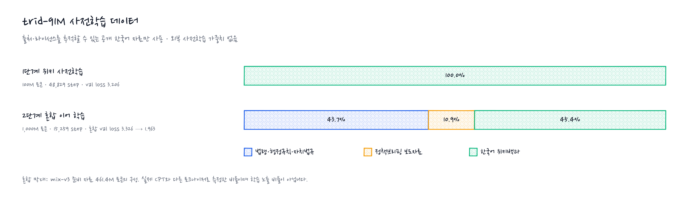
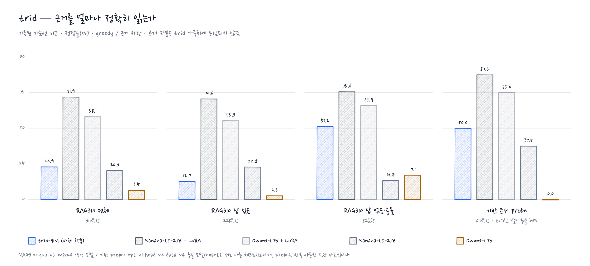
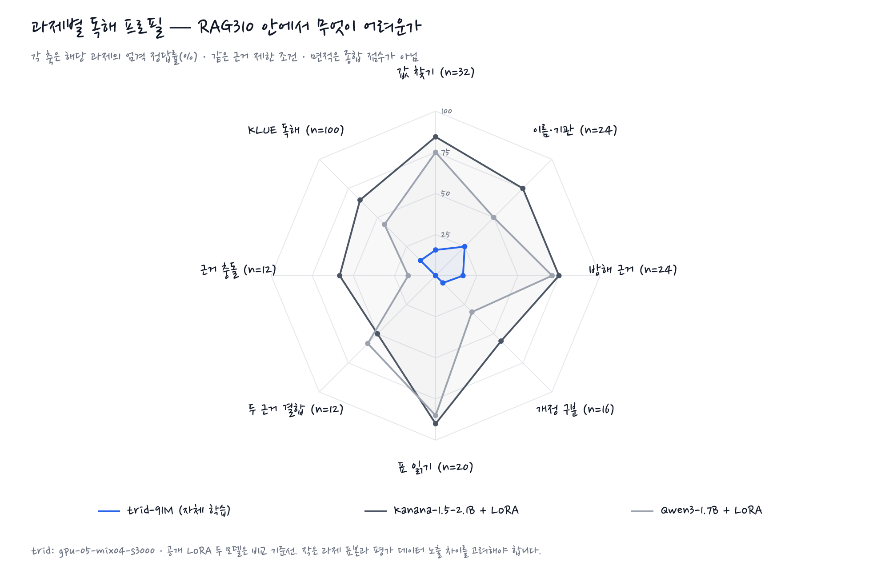
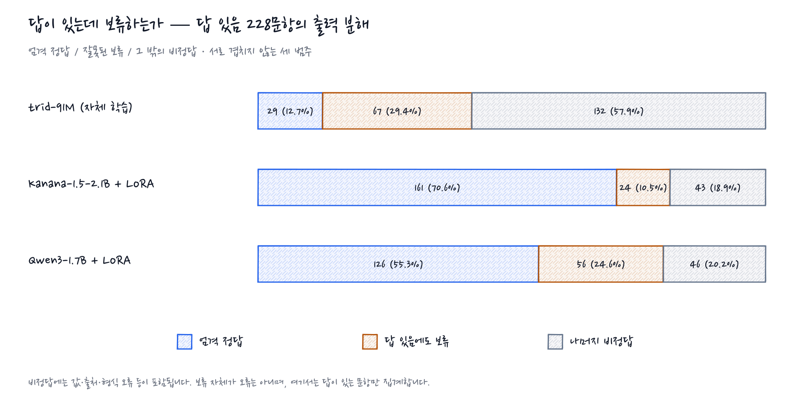
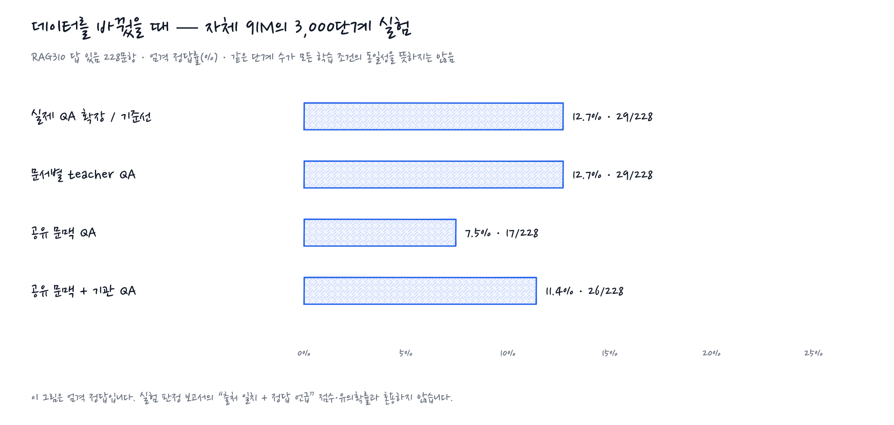

<h1 align="center">trid</h1>

<p align="center"><b>공공기관 문서를 읽는 자체 학습 한국어 sLLM</b><br>
외부 사전학습 가중치 없이, 문서의 근거와 질문을 연결하는 작은 언어모델을 만듭니다.</p>

<p align="center">
<a href="#모델-구조">모델 구조</a> · <a href="#학습">학습</a> · <a href="#평가">평가</a> ·
<a href="docs/SERVICE.md">실행 안내</a> · <a href="docs/SECURITY.md">보안</a>
</p>

## 소개

trid는 대한민국 공공기관·공기업의 규정, 공고, 보도자료를 읽고 한국어 질문에 답하기 위한 소형 언어모델입니다. 기관 내부망에서 외부 API 없이 실행하고, 답의 출처를 확인할 수 있는 문서 질의응답을 목표로 합니다.

토크나이저를 직접 학습하고 Transformer 가중치는 무작위 초기화부터 학습합니다. Qwen·Kanana의 가중치를 trid에 넣지 않습니다. 저장소에 있는 공개 모델 학습·평가 결과는 **비교 실험**이며 자체 모델과 구분합니다.

현재는 **91M 모델의 독해력 개선**과 **350M급 구조 후보 검증**을 진행하고 있습니다. 근거 기반 설명까지 개발 범위를 넓히되, 현재 검증된 출력은 짧은 값·출처 또는 보류 응답 중심입니다. 범용 대화·설명 능력이나 실무 배포 준비가 완료된 모델은 아닙니다.

## 모델 구조

<p align="center"></p>

두 구성 모두 decoder-only Transformer에 RoPE, pre-norm RMSNorm, SwiGLU, 공유 입·출력 임베딩을 사용합니다.

| 항목 | trid-91M — 기존 실험 모델 | 350M급 — 다음 구조 후보 |
|---|---|---|
| 설정 | [korean-medium-91m.json](configs/korean-medium-91m.json) | [korean-350m.json](configs/korean-350m.json) |
| hidden / 층 수 | 768 / 12 | 1,024 / 28 |
| query head / KV head | 12 / 12 | 16 / 4 (GQA) |
| FFN hidden | 2,048 | 3,072 |
| QK-norm | 끔 | 켬 |
| 어휘 / 문맥 | 8,192 / 1,024 | 8,192 / 1,024 |
| 상태 | 사전학습·SFT·추출 독해 평가 기록 있음 | 설정 추가 및 작은 학습 실행 확인 기록; 독해 성능 미확인 |

위 구조 그림은 **91M** 기준입니다. 350M급 후보는 크기뿐 아니라 GQA와 QK-norm도 바뀌므로, 앞으로의 비교를 순수한 파라미터 수 증가 효과로 해석하지 않습니다. 후보를 기존 모델보다 우수하다고 판단할 평가 결과는 아직 없습니다.

### 질문에 답하는 방법

근거 문단을 `[D1]`, `[D2]`처럼 표시해 질문과 함께 입력합니다. 문서 QA의 제한 출력은 다음과 같습니다. 아래는 출력 형식 예시이지 실제 모델의 시연 결과는 아닙니다.

```text
8만 원 [D3]      근거에서 고른 값과 출처
확인 불가         근거 부족
근거 충돌         근거 사이의 모순
```

- **생성형 독해**: 다음 토큰을 예측하되, 근거 제한 디코딩에서는 인용 문단의 부분 문자열과 유효한 출처 번호만 허용합니다.
- **구간 점수화**: 근거 안의 후보 구간을 `값 [Dn]`으로 만들고 전체 로그우도로 비교합니다.
- **추출 독해기**: 몸통에 답 있음·없음·충돌 분류와 시작·끝 위치 헤드를 붙여, 문서 구간을 직접 고릅니다. 출처는 해당 구간의 문단에서 정합니다.

**복사 제한은 정확성 보장이 아닙니다.** 근거 안의 잘못된 값이나 악성 지시문도 선택할 수 있습니다. 이 제약은 일반 자유 생성·설명 답변에 자동 적용되지 않으며, 개인정보 마스킹·권한 필터·보안 평가가 별도로 필요합니다.

## 학습

<p align="center"></p>

그림은 자체 학습과 문서 QA의 전체 흐름입니다. 초기 Mac 실험에서 시작했으며, 이후 이어 사전학습과 SFT에는 CUDA GPU도 사용했습니다.

<p align="center"></p>

- **사전학습**: 한국어 위키백과, 국가법령정보센터 자료, 정책브리핑 보도자료를 사용합니다. 정제·개인정보 치환·중복 제거를 거치고 출처와 라이선스를 기록합니다.
- **지도학습**: 합성 기관 문서 QA, KLUE MRC, TyDi QA 한국어와 실제 보도자료 기반 QA를 사용합니다. 같은 문서에서 질문을 바꿨을 때 답도 올바르게 바뀌는지 확인하는 실험을 진행했습니다.
- **질문 작성 보조**: 일부 실제 문서 QA는 공개 모델이 질문 초안을 작성하고 다른 모델이 검증합니다. 해당 QA의 답은 원문에서 복사하고 작성·검증 모델을 기록합니다. 이는 외부 가중치를 이어받는 학습과 다릅니다.

혼합 자료 막대는 **준비된 말뭉치의 측정값**입니다. 측정용 토크나이저가 실제 CPT 토크나이저와 달라 학습 중 토큰 노출 비율로 읽으면 안 됩니다. 위키 검증 손실과 혼합 검증 손실도 데이터가 달라 직접 비교할 수 없습니다.

### 현재 개발 과제

1. **질문을 실제로 읽는 독해** — 같은 지문에 서로 다른 질문을 넣고 답 변화와 정답 여부를 함께 측정합니다. 공유 문맥으로 묶은 QA 실험은 기존 기준선 대비 개선을 입증하지 못했습니다. [실험 판정](reports/public-dialogue-gpu-07-assessment.json)
2. **모델 규모와 구조 검증** — 350M급 후보를 기존 91M과 구분해 검증합니다. 작은 학습에서 loss가 내려가는 것과 문서 독해력이 좋아지는 것은 별개입니다.
3. **근거 기반 설명과 어려운 문서** — 조건·예외, 표, 두 근거 결합, 근거에 따른 설명을 개발 과제로 다룹니다. 짧은 값 추출 성능을 설명 품질로 대신하지 않습니다.

학습 계보와 실패 기록은 [사전학습 기록](docs/experiments/PRETRAINING.md), [RAG 실험 기록](docs/experiments/KOREAN_RAG.md), [연구 기록](docs/RESEARCH_LOG.md)에 보존합니다.

## 평가

### 평가 범위와 지표

| 평가 | 무엇을 측정하나 | 판정 |
|---|---|---|
| RAG310 전체·답 있음·답 없음 | 근거를 제공했을 때 값과 출처를 맞히는가 | 엄격 정답: 값·출처·출력 형식 모두 일치 |
| RAG310 과제별 분석 | 표, 개정, 방해 문서, 다중 근거에 대응하는가 | 동일 체크포인트·동일 디코딩의 과제별 엄격 정답률 |
| 잘못된 보류 | 답이 있는데도 회피하는가 | 답 있음 문항에서 보류한 비율; 낮을수록 좋음 |
| 기관 문서 probe | 실제 보도자료의 값을 추출하는가 | 추출 독해기는 허용 답 문자열과 exact 일치 |
| 구조 그래프 검색 | 답에 필요한 여러 문단을 모두 찾는가 | 필요한 근거 전체 회수율; 답변 정답률과 별개 |

아래 그림은 새로운 모델 추론이 아니라 **저장된 원본 응답·집계의 시각화**입니다. MMLU, 수학, 코드 생성 같은 범용 벤치마크 점수로 대체해서 읽으면 안 됩니다. 이 README에 제시하는 범위는 문서 독해·보류·검색이며, 350M 후보에 점수를 부여하지 않습니다.

### 공개 모델과의 기준선 비교

<p align="center"></p>

이 그림은 **기존 체크포인트의 기록된 기준선**입니다. 350M 후보의 결과나 현재 배포 모델의 통합 성능이 아닙니다. 새 실험을 가장 좋은 결과로 자동 교체하지 않습니다.

- **RAG310**: 자체 작성 160문항 + KLUE dev 150문항. 질문과 근거를 이미 제공한 독해 평가로, 검색 포함 서비스 성능은 아닙니다. trid는 `public-dialogue-gpu-05-mix04-s3000` 생성 모델입니다.
- **기관 probe**: 실제 보도자료 기반 40문항. trid는 별도 `cpt-v1/head-v2/data-v4` 추출 독해기의 `exact`입니다. 생성 모델의 값·출처·형식 채점과 동일한 지표가 아닙니다.
- **외부 기준선**: Qwen3·Kanana와 그 LoRA 결과입니다. 공개 모델에도 근거 제한 문법을 적용한 조건이며, 각 모델의 범용 능력 순위를 뜻하지 않습니다. 외부 모델의 사전학습 데이터 노출 여부는 확인할 수 없습니다.
- **평가 한계**: 기관 probe와 개발 중 반복 확인한 평가는 새 독립 최종 평가가 아닙니다. 합성 문항과 실제 기관 문서 성능도 구분합니다.

[생성 모델 원본 보고서](reports/open-weight-baseline/) · [공개 모델 비교](reports/open-weight-lora/) · [추출 독해 결과](reports/reader-factorial-01-two-complete.json)

### 과제별 능력: 레이더

<p align="center"></p>

모든 축은 **0–100% 엄격 정답률**로 방향과 척도가 같습니다. 각 축에 문항 수를 표시하며, 축별 표본 수가 다르므로 다각형의 면적을 종합 점수로 사용하지 않습니다. 이 레이더는 RAG310 중 답 없음 과제를 제외한 8개 유형을 보여주며, 전체 평가를 대신하지 않습니다.

trid의 표 읽기·두 근거 결합·충돌 판정은 이 체크포인트에서 정답을 내지 못했습니다. 원문 문자열만 출력하도록 제한하는 것과, 질문에 맞는 문자열을 선택하는 것은 다른 능력임을 보여줍니다. 공개 모델과의 차이는 파라미터 수만의 효과가 아니라 사전학습량·자료·후학습의 차이도 포함합니다.

### 답변 품질: 보류와 오답 분리

<p align="center"></p>

전체 정답률만 보면 답이 없는 문항을 자주 보류하는 모델이 유리해질 수 있습니다. 따라서 **답이 있는 문항만** 떼어 정답·보류·나머지 비정답으로 분해합니다. 각 막대는 같은 문항 수를 분모로 하며 세 범주의 합은 100%입니다.

여기서 나머지 비정답은 모두 환각이라고 단정할 수 없습니다. 값 선택, 출처, 형식 등 여러 실패가 섞여 있습니다. 반대로 근거가 없는 문항에서의 올바른 보류는 앞의 전체 비교에 별도로 포함합니다.

### 학습 데이터 실험 비교

<p align="center"></p>

네 실험 모두 자체 91M의 생성 모델이며 RAG310 답 있음 문항을 **같은 엄격 지표**로 비교합니다. 질문을 같은 문맥에 여러 개 묶은 구성이 자동으로 독해력 개선을 만들지는 않았습니다. 문서별 teacher QA도 이 엄격 지표에서는 기준선과 같았습니다.

이는 데이터만의 깨끗한 인과 비교를 의미하지 않습니다. 공유 문맥 구성은 일부 지문을 제외하고 입력 길이·방해 근거 수도 바꿉니다. 또한 이 그림의 엄격 정답과 실험 판정 보고서의 느슨한 `출처 일치 + 정답 언급` 지표를 혼용하지 않습니다.

[teacher QA 실험 판정](reports/public-dialogue-gpu-06-assessment.json) · [공유 문맥 실험 판정](reports/public-dialogue-gpu-07-assessment.json) · [모든 원본 점수](reports/open-weight-baseline/summary.md)

### 검색 품질과 지연

실제 법령·행정규칙·자치법규 **3,000문서 / 109,380문단**의 검색 결과입니다. 다중 근거 개발 문항 80개에서 필요한 근거를 **모두** 찾았는지 측정했습니다.

| 검색 방식 | 반환 상한 | 전체 근거 회수율 | 실제 평균 반환 문단 | 검색 p50 | 검색 p95 |
|---|---:|---:|---:|---:|---:|
| BM25 | 12 | 6.25% | 12.00 | 41.08 ms | 61.98 ms |
| BM25 상위 3개 + 2홉 그래프 | 12 | 16.25% | 4.70 | 41.94 ms | 62.24 ms |
| BM25 | 20 | 17.50% | 20.00 | 41.17 ms | 62.46 ms |
| BM25 상위 5개 + 2홉 그래프 | 20 | 22.50% | 7.92 | 41.32 ms | 62.80 ms |

반환 **상한**은 같아도 실제 반환 개수는 다릅니다. 파서의 참조 경로에서 자동 구성한 문항이라 그래프에 유리할 수 있고, 사람이 만든 독립 정답셋이 아닙니다. 시간은 단일 프로세스의 검색 호출 기준으로, 모델 추론·HTTP·동시 요청을 포함하지 않습니다. [원본 측정과 재현 조건](reports/graph-retrieval-v1.md)

<details>
<summary><b>차트 데이터와 재현</b></summary>

`scripts/plot_readme_figures.py`는 모델을 실행하지 않고 저장된 보고서를 읽습니다.

- 비교·레이더·보류 분석의 자체 모델: `reports/open-weight-baseline/rag310-trid-public-dialogue-gpu-05-mix04-s3000-evidence.json`
- 공개 비교 모델: `reports/open-weight-lora/rag310-{kanana,qwen3}-lora.json`의 `evidence_constrained`
- 데이터 실험: `reports/open-weight-baseline/rag310-trid-public-dialogue-{gpu-05-mix04,gpu-06-mix05,gpu-07-shared-ctx-01,gpu-07-mix06}-s3000-evidence.json`
- 기관 추출 결과: `reports/reader-factorial-01-two-complete.json`

차트 생성은 Python 표준 라이브러리, PNG 변환은 `rsvg-convert`를 사용합니다. 아키텍처 그림과 동일한 `Nanum Pen Script` 폰트가 필요합니다. 전체 생성의 학습 데이터 그림은 별도 로컬 `runs/`·`data/` 자료를 요구하지만, 새 레이더·오류·실험 비교 그림은 커밋된 보고서만으로 생성됩니다.

</details>

## 폐쇄망 서비스

<p align="center"></p>

HWP·HWPX·PDF·텍스트에서 문단을 추출하고, Kiwi 형태소 분석과 BM25로 검색합니다. 법·장·조·항·호 및 명시 참조를 파싱한 구조 그래프로 관련 조문을 확장합니다. 권한 필터와 감사 로그는 모델 밖 서비스 계층에서 처리합니다.

그림은 **목표 구조**를 포함합니다. 특히 risk–coverage 기반 보류 확률 보정과 CPU 지연 목표를 이미 달성했다고 주장하지 않습니다. 모델 점수, 서비스 전체 지연, 보안성은 별도로 검증합니다.

## 실행

가중치는 아직 공개 배포하지 않습니다. 아래 명령은 의존성과 **호환되는 자체 모델의 로컬 run 폴더**를 준비한 개발 환경용입니다. 공개 모델용 HF 체크포인트를 그대로 넣는 명령이 아닙니다.

```sh
uv sync --frozen --python 3.12 --extra service

# <documents>와 <run>을 실제 경로로 바꿉니다.
.venv/bin/trid ingest <documents> --index index/
.venv/bin/trid ask --index index/ --run runs/<run> --user kim '숙박비 상한은 얼마인가?'
.venv/bin/trid serve --index index/ --run runs/<run>
```

HWP는 [rhwp](https://github.com/edwardkim/rhwp), PDF는 poppler의 `pdftotext`가 필요합니다. 오프라인 설치, 사용자 권한, API 인증과 실행 조건은 [서비스 안내](docs/SERVICE.md)를 참고하세요. GGUF 내보내기는 지원되는 생성 모델 경로이며 추출 헤드를 포함한 서비스 전체 변환을 뜻하지 않습니다.

## 라이선스

코드는 [Apache License 2.0](LICENSE)입니다. 데이터에는 위키백과·KLUE의 CC BY-SA, 정책브리핑의 공공누리 제1유형, TyDi QA의 Apache 2.0 등 자료별 조건이 적용됩니다. 법령 등 비보호 저작물과 사이트의 다른 콘텐츠를 구분하며 각 데이터의 출처·이용 조건은 `provenance.json`과 원 출처를 확인합니다. 코드 라이선스가 모든 데이터나 향후 가중치의 이용 조건을 대신하지 않습니다.
