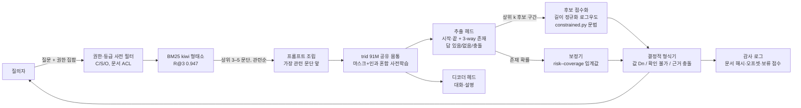

# 폐쇄망 기관 QA를 위한 trid 구조 조사

작성일: 2026-10-28. 대상: `trid` 91M decoder-only Transformer(12층·768·12 head, 문맥 1,024, 자체 8k byte-level BPE, RoPE/SwiGLU/RMSNorm, 입·출력 임베딩 공유, GQA·QK-norm 옵션). 과제는 "검색된 기관 문단을 받아 근거 안의 값을 그대로 복사해 `값 [Dn]`으로 답하거나 `확인 불가`/`근거 충돌`로 보류"하는 것이다. 현재 held-out 결과는 17M 세대가 자유 생성 0/310, 근거 복사 제한 디코딩 3/310이고([README](../docs/RESEARCH_LOG.md), [KOREAN_RAG.md](../docs/experiments/KOREAN_RAG.md)), 검색은 BM25+kiwi R@3 0.947로 병목이 아니다([reports/retrieval-benchmark-v1.md](retrieval-benchmark-v1.md)).

전제: **외부 사전학습 생성 모델 가중치는 쓰지 않는다**(검색기는 미결 질문, [korean-oss-opportunities.md §5.2](korean-oss-opportunities.md)). 학습은 Mac 한 대(MPS, 91M 기준 약 2.5k tokens/s, [KOREAN_RAG.md](../docs/experiments/KOREAN_RAG.md))에서 한다. 이 문서는 코드를 바꾸지 않았고 학습도 돌리지 않았다.

표기: 판정은 **적합**(91M·Mac·정책 안에서 바로 넣을 수 있음) / **실험**(소규모 비교 후 결정) / **부적합**(규모·정책·비용상 안 맞음). 난이도는 S(하루 이내)/M(며칠)/L(주 단위). 추론은 `[INFERENCE]`로 표시한다.

---

## 0. 요약

| 영역 | 핵심 발견 | 판정 |
|---|---|---|
| 1. 추출 vs 생성 | 같은 레시피로 짝지어 학습한 Ettin 연구(17M–1B)에서 인코더는 분류·검색, 디코더는 생성에 강하고, 사후 전환은 손해가 크다([arXiv 2507.11412](https://arxiv.org/abs/2507.11412)). KLUE-MRC에서 68M 인코더(KLUE-RoBERTa-small)가 EM 57.3을 내고([KLUE Table 32](https://arxiv.org/html/2105.09680v4)), ELECTRA-Small++ 설정(약 14M)의 KoELECTRA가 KorQuAD 1.0 dev EM 82.1을 낸다([KoELECTRA README](https://github.com/monologg/KoELECTRA/blob/master/finetune/README.md)). trid의 과제는 "짧은 문맥에서 구간 복사"이므로 추출형이 맞는 쪽이다([Luo et al. 2022](https://arxiv.org/abs/2203.07522)). | **적합: 91M 몸통 위에 구간·보류 헤드** |
| 2. 검색 통합 구조 | RETRO/RETRO++·Memory Layers·kNN-LM·Self-RAG·GraphRAG는 1B 이상 또는 외부 대형 모델·수십억 토큰 데이터베이스를 전제한다. 91M에 맞는 것은 RAFT식 방해 문서 SFT(이미 v2 자료에 반영)와 Block-Attention식 문단별 KV 재사용뿐이다. ColBERT는 검색기 정책이 결정되면 trid 몸통으로 학습 가능. | 적합(RAFT), 실험(Block-Attention, ColBERT), 부적합(나머지) |
| 3. 충실성·보류 | 선택적 QA(risk–coverage) 보정, 3-way 존재 판단(답 있음/없음/충돌), 세밀 인용(FRONT, Attribute-first)이 91M에 옮길 수 있는 틀이다. `trid/constrained.py`는 2026년 논문(Constrained Tagging, CHyD)과 같은 보장을 이미 주지만, 토큰 greedy라서 `2`로 시작하는 값에 쏠리는 편향이 생긴다 → 후보 구간 전체를 점수화하는 방식으로 바꿔야 한다. | 적합 |
| 4. 효율 구조 | SSM/하이브리드는 **복사 과제에서 Transformer보다 근본적으로 약하다**([Jelassi et al. 2024](https://arxiv.org/abs/2402.01032))는 점에서 trid 과제와 반대 방향. MLA·MoE·memory layer는 1B 이상에서만 검증. 91M에서 증거가 있는 것은 deep-and-thin + 임베딩 공유(MobileLLM, SmolLM2), 슬라이딩+전역 attention(Gemma 3), QK-norm, 차등 attention(Diff Transformer). CPU 배포는 int8 동적 양자화 또는 llama.cpp `llama`/`qwen3` 아키텍처로의 GGUF 매핑이 가능. | 실험(깊이·Diff attention), 적합(int8·GGUF) |
| 5. 데이터 효율 | 반복 4 epoch까지는 손실 차이가 무시할 만하다([Muennighoff et al. 2023](https://arxiv.org/abs/2305.16264)) → 10억 토큰 말뭉치를 4번 돌려 40억 토큰 예산을 쓸 수 있다. 혼합 비율은 소형 프록시로 예측 가능(Data Mixing Laws, RegMix). phi식 합성 교과서와 대형 교사 증류는 정책상 불가. BabyLM 2024 우승 GPT-BERT(마스크+인과 혼합)는 100M 단어 규모 증거라 trid에 직접 적용 가능. | 적합(반복·혼합법칙·GPT-BERT), 부적합(합성 교과서·외부 증류) |
| 6. 폐쇄망 배포 | 국정원 N²SF(C/S/O 등급, 권한·인증·분리·통제·데이터·정보자산 6개 통제)와 개인정보위 생성형 AI 안내서(2025.8), NIA 공공부문 AI 가이드(2026.5)가 기준. 문서 권한은 검색 **전** 필터링이 원칙(participant-aware access control). 감사 로그는 질의·검색 문서 id·답 구간 오프셋·보류 사유를 남겨야 한다. | 적합(설계 요건) |

마지막 절에 trid v1 목표 구조(mermaid), 순위별 실험 5개, 91M으로 내려오지 않는 것 목록이 있다.

---

## 1. 소규모 근거 QA에서 추출 vs 생성

### 1.1 인코더·추출형 독해기

| 항목 | 내용 | 핵심 수치 | 91M·Mac 적합성 | 난이도 | 위험 |
|---|---|---|---|---|---|
| KLUE-MRC 소형 인코더 기준선 | 질문+문단 → 시작·끝 위치. 답 없음 포함. | KLUE 테스트: KLUE-RoBERTa-small(68M) EM 57.32 / ROUGE-W 62.70, KLUE-BERT-base(110M) 62.32/68.51, KLUE-RoBERTa-base(110M) 68.67/73.98, RoBERTa-large(337M) 75.58/80.59 ([KLUE Table 32](https://arxiv.org/html/2105.09680v4); 파라미터는 Table 31). | **적합**. trid 91M은 BERT-base와 같은 급이다. 다만 이들은 수십 GB 말뭉치로 MLM 사전학습했고 trid는 1억 토큰 인과 LM이므로 그대로 기대하면 안 됨. | M | 사전학습 목적(인과) 차이로 양방향 헤드가 바로 붙지 않음 → §1.4, §5.4 |
| KorQuAD 1.0 소형 인코더 | ELECTRA-Small++ 설정(원 논문 기준 약 14M) 한국어 모델 | KoELECTRA-Small-v3 dev EM 82.11 / F1 91.13, Base-v3 84.83/93.45 ([KoELECTRA README](https://github.com/monologg/KoELECTRA/blob/master/finetune/README.md)) | **적합**(규모 근거). 14M 인코더로도 KorQuAD 80점대 → "91M이라 구간을 못 찾는다"는 설명은 성립하지 않는다. 사전학습 토큰 수(34GB)와 목적이 차이의 원인. | — | — |
| DeBERTaV3-xsmall | 12층·384, 몸통 22M, ELECTRA식 RTD 사전학습 | SQuAD 2.0 dev F1 84.8 / EM 82.0 (답 없음 포함) ([모델 카드](https://huggingface.co/microsoft/deberta-v3-xsmall/blob/main/README.md), [arXiv 2111.09543](https://arxiv.org/abs/2111.09543)) | 실험(사전학습 목적만). disentangled attention 자체는 RoPE와 겹치므로 안 넣음. RTD(생성기–판별기)는 두 모델 학습이라 Mac에서 비용 2배. | L | 토큰 치환 판별 사전학습은 한국어 8k 어휘에서 검증된 바 없음 |
| ModernBERT | 2024-12. 8,192 문맥, RoPE, GeGLU, 교대 전역/지역 attention, 2T 토큰, 영어·코드 ([arXiv 2412.13663](https://arxiv.org/abs/2412.13663)) | base 149M / large 395M. 영어 전용 | 실험(레시피만). 가중치는 정책상·언어상 무관. "지역 128 토큰 + 3층마다 전역"은 §4.3의 슬라이딩 설계 근거. | — | — |
| EuroBERT | 2025-03. 210M/610M/2.1B, 8,192 문맥, 15개 언어 ([arXiv 2503.05500](https://arxiv.org/abs/2503.05500)) | 지원 언어 메타데이터에 ko 없음(en·zh·ja·vi·ar·tr·hi 등) ([HF README](https://huggingface.co/EuroBERT/EuroBERT-210m/raw/main/README.md)) | 부적합(한국어 미포함, 외부 가중치). | — | — |
| Ettin(Seq vs Seq) | 17M–1B 인코더·디코더를 **같은 데이터·레시피**로 짝지어 학습 ([arXiv 2507.11412](https://arxiv.org/abs/2507.11412), ICLR 2026) | 인코더는 분류·검색, 디코더는 생성에 우위. 디코더를 이어 학습해 인코더로 바꾸면 "400M 인코더가 1B 디코더를 MNLI에서 이김" | **핵심 근거**. trid가 "읽고 위치를 찍는" 과제에 디코더 하나로 버티는 것은 이 결과와 반대. 17M급에서도 짝 비교가 있어 소규모 증거다. | — | 사후 전환이 손해라는 결과는 "처음부터 혼합 목적으로 사전학습"(§1.4)을 권한다 |
| 추출 vs 생성 독해기 체계 비교 | 9개 PLM으로 추출형/생성형 독해기 비교 ([Luo et al. 2022](https://arxiv.org/abs/2203.07522)) | 생성형은 긴 문맥, 추출형은 짧은 문맥·도메인 밖 일반화에 유리; T5 인코더가 강한 추출기 | trid 입력(근거 3–5개 문단, 1,024 토큰 이내)은 "짧은 문맥"이고 평가셋이 학습 생성기와 분리된 "도메인 밖"이므로 추출형 쪽. | — | — |
| QASE(EMNLP 2024) | 생성 PLM에 질문-주의 구간 추출 모듈을 붙여 MRC 향상 ([ACL Anthology](https://aclanthology.org/2024.emnlp-main.560.pdf)) | 구간 추출 보조 모듈이 생성 모델의 MRC를 개선 | 실험. "디코더 + 구간 헤드" 결합 설계의 선례. | M | 모듈 설계가 특정 PLM에 묶여 있음 |

### 1.2 포인터·복사 메커니즘

- Pointer Networks([arXiv 1506.03134](https://arxiv.org/abs/1506.03134)), CopyNet([arXiv 1603.06393](https://arxiv.org/abs/1603.06393)), pointer-generator([arXiv 1704.04368](https://arxiv.org/abs/1704.04368))는 출력 분포를 "어휘 생성 ⊕ 입력 위치 복사"로 섞는다. trid의 `constrained.py`는 이를 학습 없이 디코딩 시점에 강제하는 것과 같다. 차이는 포인터가 **위치**를 고르는 반면 trid는 **바이트열**을 고른다는 점이며, 같은 값이 두 문서에 있을 때 포인터는 출처를 자연히 결정하지만 바이트 복사는 `[Dn]`을 따로 맞혀야 한다. 2026년의 Constrained Tagging([arXiv 2610.28922](https://arxiv.org/abs/2610.28922))도 같은 문제를 지적한다: "반환된 구간이 입력에 없거나 여러 번 나타난다".
- Copy Is All You Need(CoG, [ICLR 2023](https://arxiv.org/abs/2307.06962))는 아예 다음 토큰을 "문서 모음의 구절 복사"로 바꾼 생성기다. 구절 인덱스를 미리 만들어야 하므로 "검색 후 복사" 구조와 잘 맞지만, 구절 임베딩 데이터베이스가 필요해 폐쇄망 문서가 바뀔 때마다 재인코딩이 필요하다 → 실험 가치는 있으나 §2의 kNN-LM과 같은 운영 부담.
- 판정: **적합(설계 원리)**. 구현은 "구간 헤드"(§1.4)가 포인터의 역할을 하고, `constrained.py`는 형식 보장 역할로 남긴다.

### 1.3 retrieve-then-extract 파이프라인

DPR([arXiv 2004.04906](https://arxiv.org/abs/2004.04906))의 원 구성은 "bi-encoder 검색 + BERT 추출 독해기"였고, FiD([arXiv 2007.01282](https://arxiv.org/abs/2007.01282))가 생성 독해기로 바꾼 뒤 생성형이 주류가 됐다. 그러나 FiD의 이득은 T5-base/large(220M/770M)에서 "문단 100개를 종합"하는 설정에서 측정된 것이고, trid 과제는 "여러 문단을 종합해 새 문장을 쓰는 것"이 아니라 "한 문단의 값을 그대로 옮기는 것"이다. Attribute First, then Generate([ACL 2024](https://arxiv.org/abs/2403.17104))는 "먼저 근거 구간을 고르고(select) 그 구간이 곧 인용(attribute)이 되게 한 뒤 생성"하는 3단계로 나누면 인용 정확도와 검증 시간이 좋아진다고 보고한다. trid v1은 이 중 **select 단계만으로 답이 끝나는** 과제이므로 생성 단계는 선택 사항이다.

trid 자체 기록과 대조하면: 17M 약한 base에서 구간 헤드를 붙인 `korean-span-v1`은 검증 196문항 중 정확 17, 보류 0/96이었고([reports/korean-span-v1-summary.json](korean-span-v1-summary.json)), 같은 base의 생성 독해 `korean-reading-v1`은 정확 2/135였다([reports/korean-reading-v1-summary.json](korean-reading-v1-summary.json)). 둘 다 실패지만 구간 헤드 쪽이 8배 높았고, 실패 원인은 "답 존재 확률이 답 있음/없음에서 완전히 겹침"이라는 보정 문제였다. 이것은 §3의 보류 설계로 풀어야 할 문제이지 추출 자체의 한계가 아니다.

### 1.4 91M 몸통을 추출기로 쓰는 방법

| 방법 | 내용 | 근거 | 판정 | 난이도 |
|---|---|---|---|---|
| (a) 인과 마스크 유지 + 구간 헤드 | 질문을 앞에 두고 문서 토큰마다 시작·끝 logit. 이미 `trid/korean_reader.py`에 구현 ([KOREAN_SPAN.md](../docs/experiments/KOREAN_SPAN.md)) | 17M에서 17/196. 문서 위치가 뒤 문맥(같은 문단의 뒷부분)을 못 봄 | 실험(기준선) | S(기존 코드) |
| (b) 양방향 마스크로 전환 + MNTP 이어 학습 | LLM2Vec: 디코더에 양방향 attention을 켜고 masked next token prediction으로 적응 ([arXiv 2404.05961](https://arxiv.org/abs/2404.05961)) | Ettin은 이런 사후 전환이 "처음부터 인코더"보다 못하다고 보고하지만, trid는 어차피 몸통이 하나뿐이고 1억 토큰 수준에서 전환 비용은 작다 | **실험(1순위)** | M |
| (c) 처음부터 마스크+인과 혼합 사전학습 | GPT-BERT: 한 Transformer에 두 목적을 섞어 학습, 인과/마스크 양쪽으로 사용 가능. BabyLM 2024(100M 단어)에서 마스크 전용·인과 전용 모두를 이김 ([arXiv 2410.24159](https://arxiv.org/abs/2410.24159), [Findings](https://arxiv.org/abs/2412.05149)) | 100M 단어 ≈ trid의 1억 토큰 규모와 같은 데이터 체급에서 검증된 드문 결과 | **적합(다음 10억 토큰 사전학습에 포함)** | M |
| (d) 디코더 생성 + 제약 디코딩만 | 현행 | 17M: 3/310 | 유지(형식 보장·대화 기능용) | — |

적합성 결론: **91M 몸통 하나를 (c)로 사전학습하고, 추출 헤드(시작·끝·3-way 존재)와 디코더 헤드(대화·설명·`값 [Dn]` 형식)를 공유**한다. 생성은 답을 "만드는" 데가 아니라 추출된 구간을 형식에 맞춰 "옮기는" 데만 쓴다.

---

## 2. 검색 통합 구조

| 구조 | 무엇인가 | 핵심 결과 | 91M·Mac·정책 적합성 | 난이도 | 위험 |
|---|---|---|---|---|---|
| RETRO ([arXiv 2112.04426](https://arxiv.org/abs/2112.04426)) | 64토큰 청크마다 2T 토큰 DB에서 이웃을 가져와 chunked cross-attention | 7.5B가 25× 큰 모델 급 perplexity | **부적합**. 수조 토큰 DB·BERT 임베딩 색인·cross-attention 층이 필요. 폐쇄망 문서 수천 건에는 청크 검색이 BM25로 충분 | L | — |
| RETRO++ ([arXiv 2304.06762](https://arxiv.org/abs/2304.06762), EMNLP 2023) | RETRO 재현(최대 9.5B, 330B 토큰 DB)+"상위 검색 문서를 디코더 입력에도 넣는" 변형 | NQ EM +8.6 vs RETRO; 지식 집약 과제에서 GPT보다 우위, 그 외는 동등 | 부적합(사전학습 검색). 다만 "가장 관련 있는 문단을 디코더 입력 맨 앞에 둔다"는 RETRO++의 요점은 프롬프트 순서 규칙으로 바로 쓸 수 있다(Lost in the Middle, [arXiv 2307.03172](https://arxiv.org/abs/2307.03172)) | S(순서 규칙) | — |
| Memory Layers at Scale ([arXiv 2412.09764](https://arxiv.org/abs/2412.09764), Meta 2024) | FFN 일부를 product-key 메모리(값 1M개 이상)로 교체해 FLOPs 없이 파라미터 추가 | 134M base + 1M 값(총 937M)에서 NQ 0.91→3.16, TriviaQA 7.7→18.8 (1T 토큰 학습, [Table 1](https://arxiv.org/html/2412.09764v1)) | **부적합**. 이득은 "파라미터 안에 사실을 저장"하는 폐쇄형 QA용이다. trid는 사실을 근거 문단에서 읽어야 하며 기관 문서를 가중치에 외우는 것은 목표가 아니다([KOREAN_RAG.md](../docs/experiments/KOREAN_RAG.md)). 또 134M에서도 1T 토큰 증거이며, 논문 스스로 소형 base에서 불안정(QK-norm 필요)을 보고 | L | 암기 편향 강화 — 현재 실패 원인(학습 값 암기)을 키움 |
| kNN-LM ([ICLR 2020](https://arxiv.org/abs/1911.00172)) | 모든 학습 토큰의 (문맥 임베딩 → 다음 토큰) 저장소를 만들고 LM 분포와 보간 | Wikitext-103 perplexity 18.65→15.79 | 부적합. 저장소는 토큰당 dim×2바이트: 1억 토큰이면 ~150GB(768·2B·1e8) `[INFERENCE]`. 폐쇄망 문서만 저장하면 수백 MB로 줄지만 그것은 곧 "근거 문단 복사"이고 constrained.py가 이미 한다 | L | 운영 저장소 관리 |
| REPLUG ([arXiv 2301.12652](https://arxiv.org/abs/2301.12652)) | 검색 문서 k개를 각각 LM에 넣고 출력 분포를 앙상블; 검색기를 LM 피드백으로 학습 | GPT-3 175B 언어모델링·MMLU 향상 | 실험(저비용 변형). k=3이면 추론 3배. 앙상블보다 "각 문단에 대해 답 확률을 따로 구해 가장 높은 문단을 `[Dn]`으로" 쓰는 쪽이 출처 선택에 쓸모 있음 | S | 문단 간 비교가 보정되지 않으면 길이 편향 |
| Self-RAG ([arXiv 2310.11511](https://arxiv.org/abs/2310.11511)) | 검색 여부·관련성·지지·유용성 반영 토큰을 생성하도록 7B/13B 학습; 평가 토큰 데이터는 GPT-4로 생성 | 7B가 ChatGPT를 사실성·인용에서 능가 | **부적합**(정책: GPT-4 비평 데이터). 다만 "지지(IsSUP)" 토큰 아이디어는 §3의 3-way 존재 분류와 동일하므로 그 형태로는 적합 | — | — |
| RAFT ([arXiv 2403.10131](https://arxiv.org/abs/2403.10131)) | 정답 문서+방해 문서를 섞어 SFT, 정답 문서를 그대로 인용하는 CoT | PubMed·HotpotQA·Gorilla에서 일관된 향상(Llama-2 7B) | **적합(이미 v2 자료에 반영)**. 91M에는 CoT를 빼고 "방해 문서 무시 + 그대로 인용"만. 평가셋의 방해 근거 24문항이 직접 지표 | S | 학습 데이터 생성기가 평가셋과 분리돼야 함(이미 검사함) |
| GraphRAG ([arXiv 2404.16130](https://arxiv.org/abs/2404.16130)) / LightRAG ([arXiv 2410.05779](https://arxiv.org/abs/2410.05779)) | LLM이 개체·관계 그래프와 커뮤니티 요약을 만들어 전역 질문에 답 | GraphRAG-Bench 분석: GraphRAG는 "단순 사실 검색"에서 기본 RAG보다 자주 못하고, 이득은 다중 홉·요약형에 한정 ([arXiv 2506.05690](https://arxiv.org/abs/2506.05690)) | **부적합**(현재 과제). 그래프 구축에 대형 LLM 추출이 필요하고(정책), trid 과제는 단일 값 조회 | L | — |
| ColBERT ([arXiv 2004.12832](https://arxiv.org/abs/2004.12832)), ColBERTv2 ([arXiv 2112.01488](https://arxiv.org/abs/2112.01488)), Jina-ColBERT-v2(다국어, [arXiv 2408.16672](https://arxiv.org/abs/2408.16672)) | 토큰 단위 late interaction. 한국어 전용 공개 ColBERT는 이 조사에서 확인하지 못함 | ColBERTv2는 BEIR 도메인 밖에서 단일 벡터보다 강함 | 실험(검색기 정책 결정 후). BM25 R@3 0.947에서 남은 5%는 어휘 불일치 질문. trid 몸통(인코더 모드, §1.4)으로 KLUE-MRC 질문–문단 쌍 + 합성 쌍으로 학습하면 외부 가중치 없이 가능 | M | 검색이 병목이 아닌 지금은 우선순위 낮음 |
| Block-Attention ([ICLR 2025](https://arxiv.org/abs/2409.15355)) | 검색 문단을 블록으로 나눠 각 블록 KV를 독립 계산·캐시, 위치 재부여 후 미세조정 | 블록 미세조정 후 전체 attention과 동등, TTFT 98.7%↓ | **실험(배포 단계)**. 폐쇄망에서 문서는 고정이므로 문단별 KV를 미리 계산해 두면 CPU 첫 토큰 지연이 질문 길이에만 비례. 1,024 문맥·91M에서는 절대 지연이 작아 이득은 서버 동시성에서 나옴 | M | 블록 미세조정이 근거 간 비교(충돌 판단)를 약화할 수 있음 → 충돌 12문항으로 확인 |

Mac에서 처음부터 학습 가능한 것: RAFT식 SFT(S), REPLUG식 문단별 점수(S), Block-Attention 미세조정(M), trid 몸통 ColBERT(M). 불가능한 것: RETRO·Memory Layers·kNN-LM 전체 저장소·Self-RAG·GraphRAG.

---

## 3. 충실성·보류 학습

### 3.1 보정된 보류

| 항목 | 내용 | 핵심 결과 | 적합성 | 난이도 |
|---|---|---|---|---|
| SQuAD 2.0 답 없음 ([arXiv 1806.03822](https://arxiv.org/abs/1806.03822)) | "답 없음" 질문을 섞어 추출기가 보류하게 함 | SQuAD 1.1에서 86% F1인 시스템이 2.0에서는 66% F1 | 적합. KLUE-MRC도 같은 설정이며 trid 평가셋은 정보 없음 20 + KLUE 답 없음 50을 이미 포함 | — |
| Selective QA under domain shift ([Kamath et al. ACL 2020](https://aclanthology.org/2020.acl-main.503)) | softmax 확률 대신 별도 보정기(calibrator)를 학습해 coverage–risk 곡선으로 보류 임계값 결정 | 도메인 밖에서 softmax 보정보다 일관되게 낮은 위험 | **적합**. trid 평가셋은 학습 생성기와 분리된 가상 기관이므로 정확히 "domain shift" 상황. `korean-span-v1`의 실패("존재 확률이 답 있음/없음에서 겹침")가 이 문제 | S |
| R-Tuning ([NAACL 2024](https://arxiv.org/abs/2311.09677)) | 모델이 모르는 질문에 "모른다"를 붙여 SFT | 보류 정확도·일반화 향상 | 적합(원리). trid는 파라미터 지식이 아니라 근거 유무로 보류하므로 "근거에 없음"을 라벨로 쓰는 변형이 됨(이미 v2 자료의 정보 없음 유형) | S |
| 3-way 존재 분류 | 답 있음 / 없음 / 충돌 | Self-RAG의 IsSUP 반영 토큰, trid의 `근거 충돌` 라벨 | **적합**. 생성으로 `근거 충돌`을 쓰게 하는 대신 분류 헤드가 결정하고 형식은 결정적으로 출력 | S |

### 3.2 지식 충돌 탐지

- Knowledge Conflicts for LLMs 서베이([EMNLP 2024](https://arxiv.org/abs/2403.08319))는 충돌을 (1) 문맥–파라미터, (2) 문맥 간, (3) 파라미터 내로 나눈다. trid의 `근거 충돌`은 (2)이고, 17M의 "학습 값 암기" 실패는 (1)이다. 91M·1억 토큰 모델은 파라미터 지식이 거의 없어 (1)은 사전학습이 커질수록 오히려 커지는 위험이다.
- Context-aware decoding(CAD, [NAACL 2024](https://arxiv.org/abs/2305.14739))은 "문맥 있음 − 문맥 없음" 분포 대비로 (1)을 줄이며 학습 없이 LLaMA 요약 사실성 +14.3%. trid에서는 "근거를 뺀 프롬프트"로 한 번 더 forward 하면 되므로 비용 2배, 난이도 S. 다만 제약 디코딩과 결합하면 근거에 없는 값은 이미 막히므로 이득은 **출처·구간 선택**에서만 날 것 `[INFERENCE]`.
- Lookback Lens([EMNLP 2024](https://arxiv.org/abs/2407.07071))는 "문맥 토큰 대 생성 토큰 attention 비율"만으로 문맥 환각을 탐지하는 선형 분류기. 91M은 attention 맵을 전부 들여다볼 수 있으므로 보류 보정기의 특징으로 쓸 수 있다(S).
- 문맥 간 충돌(2)의 학습 신호: 같은 항목이 다른 값으로 두 문서에 있는 합성 예가 이미 v2 자료에 있고, 평가셋 충돌 12문항이 지표. 17M 세대는 충돌 12/12를 맞췄으나 값 문항 0/71이었으므로([KOREAN_RAG.md](../docs/experiments/KOREAN_RAG.md)) "충돌"이 쉬운 표면 신호(같은 항목명 두 번 등장)로 학습됐을 가능성을 평가셋의 두 근거 결합 12문항(두 문서를 결합해야 하는데 충돌이 아님)으로 걸러야 한다.

### 3.3 인용 학습

- ALCE([arXiv 2305.14627](https://arxiv.org/abs/2305.14627))는 인용 recall/precision을 NLI로 재는 벤치마크이고, FRONT([ACL Findings 2024](https://arxiv.org/abs/2408.04568))는 "먼저 지지 인용문을 근거에서 뽑고 그것을 조건으로 생성"하도록 LLaMA-2-7B를 학습해 인용 품질 평균 +14.21%. Attribute First, then Generate([ACL 2024](https://arxiv.org/abs/2403.17104))도 같은 "선택 → 생성" 순서다.
- trid에의 함의: 두 논문 모두 "인용은 **생성의 입력**이지 생성의 **부산물**이 아니다"라는 쪽이다. trid v1에서 `[Dn]`은 구간 헤드가 고른 문단 번호에서 결정적으로 나오게 하고, 생성 모델이 번호를 맞히게 두지 않는다. 17M 제한 디코딩에서 출처만 정답이 114/310이었던 것은 번호 생성이 거의 찍기(3–5개 중 하나)였음을 시사한다 `[INFERENCE]`.

### 3.4 제약·복사 제한 디코딩과 `trid/constrained.py` 비교

| 방법 | 보장 | trid와 차이 |
|---|---|---|
| `trid/constrained.py` | 값은 인용 문단의 글자 경계 부분 문자열, 출처는 프롬프트의 번호, 남은 토큰 안에 완성 가능한 접두어만 허용, EOS는 완성 후에만 ([KOREAN_RAG.md](../docs/experiments/KOREAN_RAG.md)) | 기준 |
| Constrained Tagging ([arXiv 2610.28922](https://arxiv.org/abs/2610.28922), 2026-10) | 바이트 수준 토큰 트라이 + FSM으로 **입력 전체를 재생산하며** 구간을 태그; 구간은 토큰 내부 글자 경계에서도 시작·끝 가능; 255,312회 중 0.022%만 실패(추론 예산 소진) | trid와 같은 "바이트 트라이·글자 경계" 설계. 입력을 통째로 다시 쓰므로 1,024 문맥 모델에는 부적합. 저자들이 "오류는 어느 구간을 고르느냐에 있지 어디에 있느냐가 아니다"라고 한 것은 trid 3/310의 원인 진단과 일치 |
| CHyD ([arXiv 2609.10046](https://arxiv.org/abs/2609.10046), 2026-09) | speculative decoding 구조를 바꿔 "인용 모드"에서 근거의 연속 구간만 허용. 기존 하이브리드 방법은 기술 도메인에서 정확 추출 40% 미만, CHyD는 거의 완벽한 추출 충실성, 정확 답 정답률 향상·유창성 지표 약간 하락 | trid는 이미 인용 모드만 있는 특수 사례. CHyD의 "모드 전환이 올바로 켜져야 보장이 성립"이라는 한계는 trid의 "보류냐 값이냐"를 모델이 정한다는 한계와 같음 |
| Attribute First(ACL 2024) | 강조된 내용과 정확히 일치하도록 제약 디코딩 사용 | 동일 원리 |
| 문법 제약 라이브러리(outlines·xgrammar) | 정규식·CFG | 문단 부분 문자열 제약은 표현 어려움([korean-oss-opportunities.md §6](korean-oss-opportunities.md)) |

`constrained.py`의 구조적 문제 하나: `choose`는 **토큰마다 greedy**다. 값 후보가 `2만원`, `2026년 3월 15일`, `30일`일 때 첫 토큰 `2`의 점수가 가장 높으면 그 뒤는 `2`로 시작하는 후보 안에서만 고르게 되고, 17M에서 관찰된 "`2`로 시작하는 쪽을 주로 골랐다"는 편향이 정확히 이것이다. 해결은 디코딩이 아니라 **점수화**다: 인용 문단에서 글자 경계 후보 구간(길이 ≤64자, 또는 숫자·날짜·고유명 패턴)을 열거하고, 각 후보를 `값 [Dn]<EOS>`까지 완성한 시퀀스의 길이 정규화 로그우도로 비교한다. 프롬프트 KV 캐시를 공유하면 후보 하나당 수 토큰 forward이므로 CPU에서도 수백 후보가 가능하다 `[INFERENCE: 후보 수 × 평균 답 길이 ≈ 수천 토큰 forward]`. 이것은 KoBEST 로그우도 선택형 평가와 같은 방식이라 구현 S. 구간 헤드(§1.4)가 생기면 후보 열거를 헤드의 상위 k 구간으로 좁힌다.

---

## 4. 2024–2026 효율 소형 구조

| 구조 | 내용 | 검증 규모·수치 | 91M·Mac 적합성 | 난이도 | 위험 |
|---|---|---|---|---|---|
| Mamba-2 ([arXiv 2405.21060](https://arxiv.org/abs/2405.21060)), Jamba ([arXiv 2403.19887](https://arxiv.org/abs/2403.19887)), Zamba ([arXiv 2405.16712](https://arxiv.org/abs/2405.16712)), Hymba ([ICLR 2025](https://arxiv.org/abs/2411.13676)) | SSM 단독 또는 SSM+attention 하이브리드 | Hymba-1.5B가 Llama-3.2-3B 대비 평균 +1.32%p, 캐시 11.67× 축소, 처리량 3.49× | **부적합(과제 적합성)**. Jelassi et al.([ICML 2024](https://arxiv.org/abs/2402.01032))은 고정 크기 상태를 가진 모델이 **문맥 복사·검색에서 Transformer보다 근본적으로 약함**을 이론·실험으로 보임(2층 Transformer는 지수 길이 복사 가능). trid 과제가 정확히 복사다. 하이브리드는 attention 층이 복사를 맡지만, 1B 미만 증거가 없고 MPS용 selective-scan 커널도 없음 | L | 문맥 1,024에서 KV 캐시(12층·2·1024·768·4B ≈ 75MB)는 병목이 아님 |
| MLA(DeepSeek-V2, [arXiv 2405.04434](https://arxiv.org/abs/2405.04434)) | KV를 저차원 잠재 벡터로 압축 | 236B MoE에서 KV 93.3% 축소 | 부적합(필요 없음). 위와 같이 KV가 병목이 아니고, GQA 옵션이 이미 있음 | M | RoPE 분리 처리로 복잡도 증가 |
| 슬라이딩 + 전역 attention(Gemma 3, [arXiv 2503.19786](https://arxiv.org/abs/2503.19786); ModernBERT) | 지역 창(1,024) 5층 : 전역 1층 | Gemma 3는 긴 문맥 KV 절감 목적 | 실험(독해 품질 목적). 문맥 1,024에서 메모리 이득은 없음. 대신 "지역 층은 문단 내부, 전역 층은 문단 간 비교"라는 귀납 편향이 충돌 판단에 도움될 가능성 `[INFERENCE]`. SDPA에 마스크만 바꾸면 되므로 구현 S | S | 전역 층 비율이 낮으면 두 근거 결합 12문항 하락 |
| Differential Transformer ([ICLR 2025](https://arxiv.org/abs/2410.05258)) | 두 softmax attention 맵의 차로 잡음 제거 | 핵심 정보 검색·환각 완화·문맥 순서 강건성 향상; 다양한 크기·토큰에서 Transformer 우위 | **실험(2순위 구조 변경)**. "무관한 문맥에 attention을 과다 배분"이 방해 문서 24문항·표 20문항의 실패 가설과 맞음. 논문은 830M~13B 보고라 91M 증거는 없음 | M | head 수 절반으로 구성되므로 하이퍼파라미터 재탐색 |
| MoE 소규모(OLMoE, [arXiv 2409.02060](https://arxiv.org/abs/2409.02060)) | 1B 활성/7B 총 | 활성 파라미터 대비 품질 | 부적합. 91M의 FFN(약 2.4M×12)을 전문가로 쪼개면 전문가 하나가 수십만 파라미터. Mac 메모리 32GB 안에서 총 파라미터를 늘릴 수는 있으나 1B 미만 MoE가 dense를 이긴 공개 증거를 찾지 못함 | L | 라우팅 불안정 |
| MobileLLM ([arXiv 2402.14905](https://arxiv.org/abs/2402.14905)) | deep-and-thin, 임베딩 공유, GQA, 블록 가중치 공유 | 125M +2.7%p, 350M +4.3%p; 블록 공유 +0.7–0.8%p (OSS 조사 §3.1) | **실험**. 임베딩 공유·GQA는 이미 있음. 30층×576(SmolLM2-135M 구성, [config](https://raw.githubusercontent.com/huggingface/smollm/main/text/pretraining/smollm2/config_smollm2_135M.yaml))은 MPS에서 커널 호출 2.5배라 처리량 하락 우려 → 20M 토큰 파일럿으로 tok/s와 BPC 비교 | S | 처리량 |
| 깊이 vs 폭 | Petty et al.: 깊이가 조합적 일반화에 유리하되 포화 ([arXiv 2310.19956](https://arxiv.org/abs/2310.19956)); Kaplan et al.: 손실은 형태에 약하게 의존 ([arXiv 2001.08361](https://arxiv.org/abs/2001.08361)) | — | 12층×768은 정상 범위. 24층×512(약 80M)와 비교 파일럿 가치 있음 | S | — |
| 임베딩 공유 ([Press & Wolf 2016](https://arxiv.org/abs/1608.05859)) | 입·출력 임베딩 묶기 | perplexity 개선·파라미터 절감 | 적합(이미 적용). 8k×768=6.3M으로 91M의 7% | — | — |
| QK-norm | q·k를 RMSNorm | Memory Layers 논문도 소형 base 안정화에 사용 | 적합(옵션 존재, bf16 전환 시 켜기) | S | — |
| CPU/엣지 추론 | int8 동적 양자화(`torch.ao.quantization.quantize_dynamic`, Linear만) → 91M FP32 365MB → ~91MB `[INFERENCE: 가중치만 계산]`; llama.cpp는 새 아키텍처 추가 절차를 문서화([HOWTO-add-model.md](https://github.com/ggml-org/llama.cpp/blob/master/docs/development/HOWTO-add-model.md)) | GPTQ([arXiv 2210.17323](https://arxiv.org/abs/2210.17323))·AWQ([arXiv 2306.00978](https://arxiv.org/abs/2306.00978))는 int4 | **적합(int8)**, 실험(int4). trid(RoPE·SwiGLU·RMSNorm·tied·GQA)는 GGUF `llama` 아키텍처와, QK-norm을 켠 구성은 `qwen3` 아키텍처와 텐서 이름 매핑만으로 대응 가능 `[INFERENCE: 두 아키텍처의 구성 요소 집합 기준; 변환 스크립트 작성·검증 필요]`. 토크나이저는 GPT-2식 byte-level BPE라 GGUF `gpt2` pre-tokenizer로 표현 가능 | S–M | **양자화 민감도**: Scaling Laws for Precision([ICLR 2025](https://arxiv.org/abs/2411.04330))과 Ouyang et al.([arXiv 2411.17691](https://arxiv.org/abs/2411.17691))은 "토큰/파라미터 비율이 높을수록(소형·과학습) 저비트 열화가 크다"고 보고. 91M에 40억 토큰(§5)은 비율 44로 높은 편 → int4는 평가셋으로 반드시 재측정, int8은 안전 범위 `[INFERENCE]` |

---

## 5. 소형 모델의 학습 데이터 효율

| 항목 | 내용 | 핵심 결과 | trid 적합성(정책 포함) | 난이도 |
|---|---|---|---|---|
| 반복 epoch ([Muennighoff et al. NeurIPS 2023/JMLR 2025](https://arxiv.org/abs/2305.16264)) | 데이터 제한 하 반복 학습의 스케일링 법칙 | 최대 4 epoch까지는 고유 데이터 대비 손실 변화가 무시할 만하고, 그 이후 추가 연산의 가치가 급감 | **적합**. 법령·행정규칙·판례·보도자료·위키 약 10억 토큰을 4번 돌리면 40억 토큰 예산. 91M·2.5k tok/s에서 약 18일 `[INFERENCE: 4e9/2.5e3/86400]` → bf16+compile(+79%, OSS 조사 §3.3)으로 약 10일 | S(스케줄만) |
| Data Mixing Laws ([ICLR 2025](https://arxiv.org/abs/2403.16952)), RegMix ([ICLR 2025](https://arxiv.org/abs/2407.01544)) | 소형 프록시 모델 여러 개로 혼합 비율–손실 관계를 적합해 큰 실행의 비율 예측 | RegMix: 1M 파라미터 모델들로 1B 실행의 최적 혼합 예측 | **적합**. 도메인 5개(법령·행정규칙·판례·보도자료·위키)라면 20M 토큰·20M 파라미터 파일럿 8–16개로 가능. 목표 지표는 held-out BPC가 아니라 **RAG 평가셋 strict** 또는 그 대리(KLUE-MRC dev 손실)여야 함 | M |
| DoReMi ([arXiv 2305.10429](https://arxiv.org/abs/2305.10429)) | 참조 모델 대비 초과 손실로 도메인 가중치 학습 | 280M 프록시로 8B 향상 | 실험(RegMix가 더 단순) | M |
| TinyStories ([arXiv 2305.07759](https://arxiv.org/abs/2305.07759)) | GPT-4가 만든 어린이 어휘 이야기로 10M 미만 모델이 유창한 영어 | — | **부적합(정책)**: 외부 대형 모델로 합성. 다만 "어휘·구조를 제한한 데이터는 작은 모델이 문법을 더 빨리 배운다"는 관찰은 v2 합성 RAG 자료(템플릿 생성, 외부 모델 없음)의 방향과 같음 | — |
| phi-1 ([arXiv 2306.11644](https://arxiv.org/abs/2306.11644)) | GPT-3.5 합성 교과서 7B 토큰으로 1.3B 코드 모델 | HumanEval 50.6% | **부적합(정책)** | — |
| 교육 품질 분류기(FineWeb-Edu식, kanana) | LLM 라벨로 FastText 분류기 학습 | — | 부적합(라벨 생성에 외부 모델). 대안: 법령·보도자료는 출처 자체가 품질 보증이므로 분류기 없이 출처 가중치로 대체 | — |
| 자기 증류(Born-Again Networks, [arXiv 1805.04770](https://arxiv.org/abs/1805.04770)) | 같은 크기 교사→학생 반복 증류 | 같은 구조에서도 학생이 교사를 상회 | 실험(정책 안). "자기 더 큰 체크포인트" 증류는 교사가 없으면 불가: 350M을 Mac에서 40억 토큰 학습하면 약 70일 `[INFERENCE: 처리량이 파라미터에 반비례한다고 가정]`이라 비현실적. 가능한 것은 (a) 같은 91M의 WSD 디케이 완료본을 교사로 다음 실행의 보조 손실, (b) 추출 헤드의 soft label로 디코더 SFT | M |
| 커리큘럼 | BabyLM 2024 Findings: 31개 제출 중 하이브리드 마스크–인과 구조(GPT-BERT)가 우승; 학습 FLOPs와 평균 성능의 상관이 강하고, 상위 제출은 데이터·목적 함수·구조를 함께 바꿈 ([arXiv 2412.05149](https://arxiv.org/abs/2412.05149)) | — | 실험. 데이터 순서보다 목적 함수(§1.4 c)와 연산량이 먼저 | — |
| 디케이 구간 SFT 혼합(MiniCPM, [arXiv 2404.06395](https://arxiv.org/html/2404.06395v2)) | WSD 디케이 구간에 고품질 SFT 데이터 혼합 | SFT만 하는 것보다 효과 큼 | 적합(OSS 조사 §3.2에서 이미 권고). RAG 합성 자료와 KLUE-MRC를 디케이 구간에 넣어 "기본 대화 퇴행" 문제를 피함 | S |

---

## 6. 폐쇄망 배포 고려사항

### 6.1 한국 공공부문 기준

| 문서 | 내용 | trid 설계 요건 |
|---|---|---|
| 국가정보원 「국가 망 보안체계(N²SF) 보안 가이드라인」 — 초안 2025-01-23([보안뉴스](https://www.boannews.com/media/view.asp?idx=135736)), 정식판 1.0 2025-09-30([연합뉴스](https://www.yna.co.kr/view/AKR20250930097800017), [NIS 보도자료](https://www.nis.go.kr:4016/common/download.do?seq=7752D3C853B405E1EFE56BD23C1A109A)) | 업무정보를 기밀(C)/민감(S)/공개(O)로 분류하고 권한·인증·분리 및 격리·통제·데이터·정보자산 6개 통제를 등급별 차등 적용. 정보서비스 모델에 "업무환경에서 생성형 AI 활용" 포함 | 모델·검색기·문서 저장소가 **같은 등급 구역** 안에서 동작하고 외부 호출이 없어야 함(trid는 가중치 다운로드·원격 API 없음 — 충족). 문서 등급(C/S/O)을 검색 필터 속성으로 보존 |
| 국정원 「챗GPT 등 생성형 AI 활용 보안 가이드라인」 2023-06-29 ([연합뉴스](https://www.yna.co.kr/view/AKR20230629042800017), [국회도서관 국가전략포털](https://nsp.nanet.go.kr/plan/subject/detail.do?nationalPlanControlNo=PLAN0000039282)) | 비공개·개인정보 입력 금지, 외부 서비스 사용 시 유출 위험 | 내부 모델은 이 금지의 **대안**이지만, 입력 로그에 비공개 정보가 남으므로 로그 자체의 등급 관리 필요 |
| 개인정보보호위원회 「생성형 인공지능(AI) 개발·활용을 위한 개인정보 처리 안내서」 2025-08-06 ([보도자료](https://pipc.go.kr/np/cop/bbs/selectBoardArticle.do?bbsId=BS074&mCode=C020010000&nttId=11410), [안내서 게시](https://pipc.go.kr/np/cop/bbs/selectBoardArticle.do?bbsId=BS217&mCode=D010030020&nttId=11439)) | 생성형 AI 생애주기를 4단계로 나눠 단계별 최소 안전조치와 법적 기준 제시([정책브리핑](https://m.korea.kr/news/policyNewsView.do?newsId=148947194)) | 학습 데이터 단계: ko-pii로 구조적 식별자 제거(OSS 조사 §2)·판례 가명처리 확인. 서비스 단계: 질의 로그 보존 기간·접근 권한 명시 |
| NIA 「공공부문 초거대 AI 도입·활용 가이드라인 2.0」 2025-04 ([NIA](https://www.nia.or.kr/site/nia_kor/ex/bbs/View.do?bcIdx=27985&cbIdx=99953)), 「공공부문 AI 도입·활용 가이드('26.5월 기준)」 2026-06 ([NIA](https://www.nia.or.kr/site/nia_kor/ex/bbs/View.do?bcIdx=29526&cbIdx=37989)) | 2026 가이드는 「인공지능 및 데이터 기반 행정 활성화에 관한 법률」(2026-08-28 시행 예정) 대응, "범정부 AI 공통기반"(공동 GPU·모델) 우선 활용, 운영 단계 성능 모니터링·데이터 갱신 | 공통기반이 아닌 자체 모델 도입은 "공통기반으로 불가능한 이유"(폐쇄망·라이선스 추적)를 문서화해야 함. 성능 모니터링 지표로 평가셋 strict·보류율을 그대로 제출 |
| 「인공지능 발전과 신뢰 기반 조성 등에 관한 기본법」 및 시행령, 2026-01-22 시행 ([법제처](https://www.law.go.kr/LSW/lsInfoP.do?efYd=20260122&lsiSeq=282879); 제31조 투명성 확보 의무 [조문](https://www.law.go.kr/LSW/lsLinkCommonInfo.do?lsJoLnkSeq=1031810727)) | 생성형 AI 결과물 표시·고영향 AI 의무 | 답변에 "AI 생성" 표시와 근거 출처·구간 오프셋을 항상 동봉(trid 형식은 이미 출처 포함) |

### 6.2 시스템 설계 문헌

| 항목 | 내용 | 요건 |
|---|---|---|
| Participant-aware access control ([arXiv 2509.14608](https://arxiv.org/abs/2509.14608)) | RAG가 권한 없는 문서를 끌어와 유출하는 공격 시연; 모든 참여자(사용자·에이전트·도구)의 권한 교집합으로 **검색 전** 제한 | 검색 색인에 문서별 ACL·등급(C/S/O) 저장, 질의자 권한으로 사전 필터. 생성 후 필터는 불충분 |
| Privacy-Aware RAG ([arXiv 2503.15548](https://arxiv.org/abs/2503.15548)), RAG 프라이버시 분석 ([arXiv 2402.16893](https://arxiv.org/abs/2402.16893)) | 검색 저장소 내용이 프롬프트 공격으로 추출될 수 있음 | trid 출력은 인용 문단의 부분 문자열로 제한되므로 "권한 있는 문단" 밖 유출은 구조적으로 불가(제약 디코딩). 단 **프롬프트에 들어간** 문단은 모두 유출 가능 범위이므로 사전 필터가 유일한 방어 |
| PoisonedRAG ([USENIX Security 2025](https://arxiv.org/abs/2402.07867)), 간접 프롬프트 주입 ([arXiv 2302.12173](https://arxiv.org/abs/2302.12173)) | 문서에 심은 텍스트로 답 조작 | 폐쇄망 기관 문서는 내부 작성이라 위험이 낮지만, 외부 접수 문서(민원·입찰)를 색인하면 해당. 값 복사 제한은 "지시 수행"을 막지만 "조작된 값 복사"는 못 막음 → 문서 출처 등급·해시 기록 |
| RAG 보안 위험 평가 틀 ([arXiv 2505.08728](https://arxiv.org/html/2505.08728v1)) | 접근 제한(M3) 등 완화책 목록 | 체크리스트로 사용 |

### 6.3 감사 로그 최소 필드

질의 해시·사용자/권한 집합·검색된 문서 id와 버전 해시·프롬프트에 들어간 문단 번호 순서·모델 가중치 해시(`weights_sha256`는 이미 보고서에 기록 중)·답 유형(값/확인 불가/근거 충돌)·값의 문단 내 바이트 오프셋·보류 점수·디코딩 모드(제약/자유)·지연. 값은 오프셋으로 기록하면 로그 자체에 민감 값을 중복 저장하지 않아도 재현 가능하다.

---

## 7. 제안: trid v1 목표 구조

- 몸통 하나, 헤드 둘. 답은 **추출 헤드 → 후보 점수화 → 결정적 형식기**로 나오고, 디코더는 설명·대화에만 쓴다. `[Dn]`은 구간이 속한 문단에서 결정되므로 번호를 "생성"하지 않는다.
- 보류는 3-way 존재 헤드의 확률을 별도 보정기(Kamath식)가 임계값으로 자른다. 임계값은 검증 split의 risk–coverage 곡선에서 정하고 평가셋은 쓰지 않는다.
- 배포는 int8 동적 양자화 CPU 또는 GGUF(`llama`/`qwen3` 매핑). 문단별 KV 사전 계산(Block-Attention)은 동시성 요구가 생길 때.

---

## 8. 순위별 실험 5개

아래 표는 최초 실험 제안이다. 당시에는 310문항 평가셋의 지표를 비교 기준으로 적었으나, 현재 개발 반복과 체크포인트 선택은 curriculum의 내부 검증셋에서만 수행한다. `data/korean-rag-eval-v1` 310문항은 개발 튜닝에 사용하지 않는다. 현재 고정된 개발 목표와 실제 기관 문서 점검 범위는 [KOREAN_RAG.md](../docs/experiments/KOREAN_RAG.md)의 「개발 판정과 실제 기관 문서 점검」을 따른다. 아래 합격 수치를 현 개발 프로토콜과 혼용하지 않는다.

| 순위 | 실험 | 첫 단계 | 결정 지표 | 통과 기준 |
|---|---|---|---|---|
| 1 | **91M base에 추출 헤드 + 3-way 존재 헤드** (§1.4 b: 양방향 마스크 전환 + MNTP 이어 학습 5천 스텝 → KLUE-MRC train 6,000 + 합성 RAG 11,200으로 헤드 학습) vs 같은 base의 디코더 SFT v2 | `trid/korean_reader.py`의 입력 형식을 `trid.prompts.rag_prompt`와 맞추고 `Attention`에 `causal=False` 경로 추가; 존재 헤드를 2-way→3-way(충돌)로 확장 | strict 전체, 그리고 값 32·이름 24·표 20의 value, 정보 없음 20+KLUE 답 없음 50의 abstained 정밀도/재현율 | strict가 디코더 SFT v2의 2배 이상이고 KLUE 100 답 있음에서 EM ≥ 40 `[INFERENCE: KLUE-RoBERTa-small 57의 70%]` |
| 2 | **후보 구간 점수화 디코딩**(§3.4): 인용 문단의 글자 경계 후보(≤64자)를 `값 [Dn]<EOS>`까지 길이 정규화 로그우도로 비교. 재학습 없음 | `constrained.py`에 `score_candidates(prefix_kv, candidates)` 추가, 후보 열거는 숫자·날짜·시각·전화·고유명 정규식 ∪ 구간 헤드 상위 k | 17M·91M SFT 모두에서 strict, 특히 값 32의 "`2`로 시작" 편향 소멸 여부 | 같은 체크포인트에서 strict가 greedy 제약 디코딩보다 높고 source 일치 ≥ 200/310 |
| 3 | **마스크+인과 혼합 사전학습(GPT-BERT)** 을 다음 10억 토큰×4 epoch 실행에 포함, cosine→WSD, 디케이 구간에 RAG 자료 혼합 | 20M 토큰 파일럿 2개(인과 only vs 혼합 1:1)에서 BPC와 1번 실험의 헤드 정확도 비교 | 파일럿: KLUE dev 손실·BPC; 본 실행: 1번 실험 지표 재측정 | 혼합이 BPC −0.05 이내 손해로 헤드 strict +5pp 이상 |
| 4 | **보류 보정기**: 존재 헤드 logit·Lookback식 attention 비율·후보 점수 차를 특징으로 한 로지스틱 보정기, 검증 split risk–coverage로 임계값 | `scripts/`에 보정기 학습·곡선 저장 스크립트, 평가 JSON에 `coverage`/`risk` 추가 | 정보 없음 20·충돌 12·KLUE 답 없음 50의 abstained 정밀도, 두 근거 결합 12의 잘못된 보류율 | 보류 정밀도 ≥ 0.8이면서 답 있음 문항의 잘못된 보류 ≤ 10% |
| 5 | **방해·충돌 대비 학습 + Diff attention 파일럿**: RAFT식 방해 비율 상향(문단 5개 중 정답 1개)과 CAD식 "근거 없는 프롬프트" 대비 손실; 별도로 Diff attention 91M 20M 토큰 파일럿 | 데이터: `prepare_rag_curriculum_v2.py`에 방해 수 옵션; 구조: `Attention`에 differential 옵션 | 방해 근거 24·표 20·개정 16의 strict; Diff 파일럿은 BPC + 1번 헤드 정확도 | 방해 24에서 strict ≥ 12/24; Diff는 BPC 동등 이상일 때만 본 실행 채택 |

실행 순서는 2(하루, 학습 없음) → 1 → 4 → 3 → 5. 2번이 먼저인 이유는 현재 체크포인트로 바로 측정할 수 있고 1번의 후보 열거 모듈을 그대로 공유하기 때문이다.

---

## 9. 91M으로 내려오지 않는 것

| 항목 | 이유 |
|---|---|
| RETRO / RETRO++ 사전학습 검색 | 수천억 토큰 검색 DB·청크 cross-attention·임베딩 색인 필요([arXiv 2304.06762](https://arxiv.org/abs/2304.06762)); 폐쇄망 문서 규모에 과잉 |
| Memory Layers | 증거는 134M+1M 값·1T 토큰; 목적이 "파라미터 내 사실 암기"라 trid의 실패 원인(암기)을 키움([arXiv 2412.09764](https://arxiv.org/abs/2412.09764)) |
| kNN-LM 전체 저장소 | 1억 토큰 저장소 ≈ 150GB `[INFERENCE]`; 문서만 저장하면 제약 디코딩과 동일 |
| Self-RAG 반영 토큰 | GPT-4 비평 데이터 필요(정책) ([arXiv 2310.11511](https://arxiv.org/abs/2310.11511)) |
| GraphRAG / LightRAG | 대형 LLM 개체·관계 추출 필요(정책); 단순 사실 조회에서 이득 없음([arXiv 2506.05690](https://arxiv.org/abs/2506.05690)) |
| SSM·하이브리드(Mamba-2·Jamba·Zamba·Hymba) | 복사 과제에서 근본적 열세([arXiv 2402.01032](https://arxiv.org/abs/2402.01032)); 1B 미만 증거 없음; MPS 커널 없음 |
| MLA | KV 캐시가 병목이 아님(문맥 1,024, 약 75MB) |
| MoE | 1B 미만에서 dense 대비 우위 증거 없음; 91M FFN을 쪼개면 전문가가 너무 작음 |
| phi식 합성 교과서·TinyStories·FineWeb-Edu식 LLM 라벨 분류기 | 외부 대형 모델 생성·라벨 필요(정책) |
| 더 큰 자체 교사로부터의 증류 | 350M을 Mac에서 40억 토큰 학습 ≈ 70일 `[INFERENCE]`; 교사가 없음 |
| 8k 이상 긴 문맥(ModernBERT·EuroBERT·Gemma 3 수준) | 1,024에서 attention 비용 64배 `[INFERENCE: 길이 제곱]`; 폐쇄망 과제는 검색으로 문단을 좁히므로 불필요 |
| KMMLU·HAE-RAE·LLM-as-judge 평가 | 무작위 수준이거나 외부 심판 필요(OSS 조사 §4) |
| int4 양자화 무검증 적용 | 소형·과학습 모델일수록 저비트 열화 큼([arXiv 2411.04330](https://arxiv.org/abs/2411.04330), [arXiv 2411.17691](https://arxiv.org/abs/2411.17691)) |

---

## 부록. 1차 출처 모음

- 추출 vs 생성: KLUE https://arxiv.org/abs/2105.09680 ; KoELECTRA https://github.com/monologg/KoELECTRA ; DeBERTaV3 https://arxiv.org/abs/2111.09543 ; ModernBERT https://arxiv.org/abs/2412.13663 ; EuroBERT https://arxiv.org/abs/2503.05500 ; Ettin https://arxiv.org/abs/2507.11412 ; Luo et al. https://arxiv.org/abs/2203.07522 ; QASE https://aclanthology.org/2024.emnlp-main.560.pdf ; LLM2Vec https://arxiv.org/abs/2404.05961 ; GPT-BERT https://arxiv.org/abs/2410.24159 ; Pointer Networks https://arxiv.org/abs/1506.03134 ; CopyNet https://arxiv.org/abs/1603.06393 ; pointer-generator https://arxiv.org/abs/1704.04368 ; CoG https://arxiv.org/abs/2307.06962 ; DPR https://arxiv.org/abs/2004.04906 ; FiD https://arxiv.org/abs/2007.01282
- 검색 통합: RETRO https://arxiv.org/abs/2112.04426 ; RETRO++ https://arxiv.org/abs/2304.06762 ; Memory Layers https://arxiv.org/abs/2412.09764 ; kNN-LM https://arxiv.org/abs/1911.00172 ; REPLUG https://arxiv.org/abs/2301.12652 ; Self-RAG https://arxiv.org/abs/2310.11511 ; RAFT https://arxiv.org/abs/2403.10131 ; GraphRAG https://arxiv.org/abs/2404.16130 ; LightRAG https://arxiv.org/abs/2410.05779 ; GraphRAG-Bench https://arxiv.org/abs/2506.05690 ; ColBERT https://arxiv.org/abs/2004.12832 ; ColBERTv2 https://arxiv.org/abs/2112.01488 ; Jina-ColBERT-v2 https://arxiv.org/abs/2408.16672 ; Block-Attention https://arxiv.org/abs/2409.15355 ; Lost in the Middle https://arxiv.org/abs/2307.03172
- 충실성·보류: SQuAD 2.0 https://arxiv.org/abs/1806.03822 ; Selective QA https://aclanthology.org/2020.acl-main.503 ; R-Tuning https://arxiv.org/abs/2311.09677 ; Knowledge Conflicts 서베이 https://arxiv.org/abs/2403.08319 ; CAD https://arxiv.org/abs/2305.14739 ; Lookback Lens https://arxiv.org/abs/2407.07071 ; ALCE https://arxiv.org/abs/2305.14627 ; FRONT https://arxiv.org/abs/2408.04568 ; Attribute First https://arxiv.org/abs/2403.17104 ; Constrained Tagging https://arxiv.org/abs/2610.28922 ; CHyD https://arxiv.org/abs/2609.10046
- 효율 구조: Mamba-2 https://arxiv.org/abs/2405.21060 ; Jamba https://arxiv.org/abs/2403.19887 ; Zamba https://arxiv.org/abs/2405.16712 ; Hymba https://arxiv.org/abs/2411.13676 ; Repeat After Me https://arxiv.org/abs/2402.01032 ; DeepSeek-V2 https://arxiv.org/abs/2405.04434 ; Gemma 3 https://arxiv.org/abs/2503.19786 ; Diff Transformer https://arxiv.org/abs/2410.05258 ; OLMoE https://arxiv.org/abs/2409.02060 ; MobileLLM https://arxiv.org/abs/2402.14905 ; SmolLM2 https://arxiv.org/abs/2502.02737 ; Petty et al. https://arxiv.org/abs/2310.19956 ; Kaplan et al. https://arxiv.org/abs/2001.08361 ; Press & Wolf https://arxiv.org/abs/1608.05859 ; GPTQ https://arxiv.org/abs/2210.17323 ; AWQ https://arxiv.org/abs/2306.00978 ; Scaling Laws for Precision https://arxiv.org/abs/2411.04330 ; Ouyang et al. https://arxiv.org/abs/2411.17691 ; llama.cpp HOWTO-add-model https://github.com/ggml-org/llama.cpp/blob/master/docs/development/HOWTO-add-model.md
- 데이터 효율: Muennighoff et al. https://arxiv.org/abs/2305.16264 ; Data Mixing Laws https://arxiv.org/abs/2403.16952 ; RegMix https://arxiv.org/abs/2407.01544 ; DoReMi https://arxiv.org/abs/2305.10429 ; TinyStories https://arxiv.org/abs/2305.07759 ; phi-1 https://arxiv.org/abs/2306.11644 ; Born-Again https://arxiv.org/abs/1805.04770 ; BabyLM 2024 Findings https://arxiv.org/abs/2412.05149 ; MiniCPM https://arxiv.org/abs/2404.06395
- 폐쇄망: N²SF 초안 https://www.boannews.com/media/view.asp?idx=135736 , 정식판 https://www.yna.co.kr/view/AKR20250930097800017 ; 국정원 생성형 AI 보안 가이드라인 https://www.yna.co.kr/view/AKR20230629042800017 ; 개인정보위 안내서 https://pipc.go.kr/np/cop/bbs/selectBoardArticle.do?bbsId=BS217&mCode=D010030020&nttId=11439 ; NIA 가이드라인 2.0 https://www.nia.or.kr/site/nia_kor/ex/bbs/View.do?bcIdx=27985&cbIdx=99953 ; NIA 2026 가이드 https://www.nia.or.kr/site/nia_kor/ex/bbs/View.do?bcIdx=29526&cbIdx=37989 ; 인공지능기본법 시행령 https://www.law.go.kr/LSW/lsInfoP.do?efYd=20260122&lsiSeq=282879 ; Participant-aware access control https://arxiv.org/abs/2509.14608 ; Privacy-Aware RAG https://arxiv.org/abs/2503.15548 ; RAG 프라이버시 https://arxiv.org/abs/2402.16893 ; PoisonedRAG https://arxiv.org/abs/2402.07867 ; 간접 프롬프트 주입 https://arxiv.org/abs/2302.12173 ; RAG 위험 평가 https://arxiv.org/html/2505.08728v1
